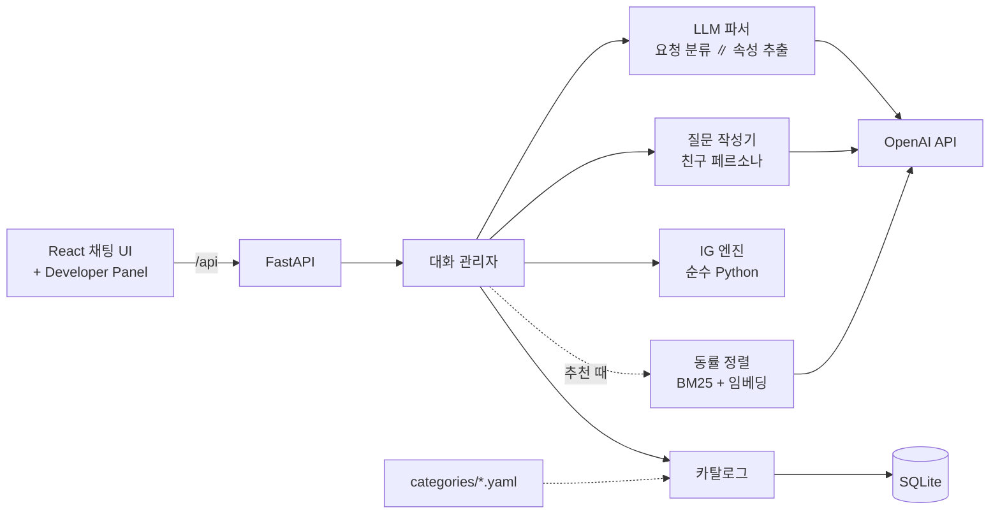

# RecommandShopping

Information Gain(IG)으로 질문을 골라 원하는 상품을 찾아 주는 대화형 쇼핑 추천 챗봇입니다. (GSDS LLM 과목 HW2)

> **📌 팀원은 [docs/briefing.md](docs/briefing.md)부터 읽어 주세요.** 과제의 현재 진행 상황을 한 문서에 정리했습니다.
> 핵심 로직, 아키텍처와 코드 지도, 평가 방법, 최신 평가 결과(run 7), 설계 결정과 근거, 남은 일과 역할 분담 후보, 실행·데모 방법이 들어 있습니다.

실제 Amazon 상품 데이터(Amazon Reviews 2023)로 카탈로그를 만들었습니다. 매 턴 **"이 질문에 답을 들으면 후보가 얼마나 줄어드는가"**(기대 정보량)를 계산해 가장 유익한 질문부터 묻습니다.
무엇을 묻고 무엇을 추천할지는 상품 데이터로 엔진이 정합니다. LLM은 자유 입력 해석(요청 분류·속성 추출), 질문 말투(친구 페르소나), 같은 조건의 상품을 대화와 가까운 순으로 정렬하는 임베딩에 씁니다.

> 문서 지도와 작업 규칙은 [CLAUDE.md](CLAUDE.md)에 있습니다.

## 할 수 있는 것

- **IG 기반 질문:** 질문마다 기대 정보량(bits)을 계산하고, 가장 큰 것을 묻습니다. 후보를 더 구별할 수 없으면 질문을 멈추고 그 한계를 알려줍니다.
- **자유 입력 해석:**
  - "무선이고 노캔 되는 걸로"처럼 여러 조건을 한 번에 말해도 됩니다.
  - 정정, "상관없어" 같은 답도 처리합니다.
  - "학생이라 돈이 없어"처럼 상황에서 값이 분명히 따라 나오면 반영합니다. 질문과 무관한 말에서도 찾습니다. 단, "지하철에서 들어"처럼 장소만으로 기능(ANC 등)을 짐작하지는 않습니다.
- **친구 같은 질문:** 기능을 직접 묻지 않고, 쓰는 장면에서 무엇을 바라는지 물어 은근히 알아냅니다. 알게 된 것은 "그럼 ~가 좋겠네"처럼 말하고 다음 질문으로 넘어갑니다. 예산은 돌려 묻지 않고 가볍게 직접 묻습니다.
- **한국어·영어:** 사용자가 쓰는 언어로 답합니다(질문, 안내 문구, 보기, 추천 근거).
- **같은 조건의 상품 정렬:** 조건이 똑같이 맞는 상품이 많으면 주 용도가 맞는 것, 대화 내용과 상품 설명이 가까운 것(키워드 검색 + 임베딩), 평점 순으로 보여 줍니다.
- **멀티턴 추천 조정:** 추천을 받은 뒤 "더 저렴한 걸로", "1번 말고", "유선으로 바꿔줘"라고 하면 목록을 다시 골라 줍니다.
- **근거와 한계 표시:**
  - 추천마다 맞는 조건, 확인할 수 없는 조건, 요청과 다른 조건을 표시합니다.
  - 동률 후보가 많거나 조건을 모두 만족하는 상품이 부족하면 그렇다고 알려줍니다.
- **Safety:**
  - 위험한 요청(총기, 마약 등)은 거절합니다.
  - 사용자가 직접 말한 조건을 어기는 상품은 추천에서 뺍니다.
- **Developer Panel:** 질문별 기대 IG, 엔트로피, 상위 후보 확률, 대화 메모리(값과 근거 발화)·질문 기록, 질문 작성기의 접근, 요청 분류, 동률 정렬 기준을 실시간으로 보여줍니다.
- **평가 모드:** Developer Panel에서 전환합니다. Amazon-C4의 실제 구매자 시나리오를 직접 연기해 채점하거나(매뉴얼), 가상 사용자(LLM)로 우리 시스템과 비교군(질문 무작위, LLM 자유 대화)을 자동 평가합니다([docs/evaluation.md](docs/evaluation.md)).

### 대화 예시 (실제 실행 결과, 2026-10-31)

평가 run 7의 한 대화다. 사용자는 실제 Amazon 구매 리뷰로 만든 가상 사용자(영어)이고, 챗봇은 실제로 산 상품을 1위로 추천했다.

```
User: Looking for a wireless headset for my laptop for work.             → 연결 방식: 무선, 마이크: 필요
Bot:  Nice—wireless with a mic for laptop work, got it. Do you want something that fully wraps your ears,
      small buds that tuck into your ear, pads that sit on your ears, or something that leaves your ears open?
User: Pads that sit on my ears — lightweight on-ear style so they don't pinch during long shifts.   → 착용 방식: 온이어
Bot:  Nice — lightweight on-ear pads that don't pinch during long shifts. Roughly what price range are you
      thinking: under $20, $20–$60, or $60+?
User: I'm aiming for the $20–$60 range — must have a solid working mic.  → 가격대: $20~60
Bot:  Do you work somewhere noisy, or do you need to hear people/alerts around you?
User: I work from home in a pretty quiet space ... don't need heavy noise isolation.               → ANC: 불필요
Bot:  ... do you ever wear them outside or during sweaty walks where they might get wet?
User: Mostly at home — I won't be sweating in them.                      → 방수: 불필요
Bot:  Got it, I'll keep Water/sweat resistance: Not needed in mind. Here's what I picked from what you told me. ...
```
(화살표는 Developer Panel의 메모리에 남은 값. 질문 아래에는 보기 버튼도 함께 나온다. 일부 문장은 줄였다.)
정답 상품의 주 용도가 데이터에는 `gaming`으로 붙어 있어, 주 용도를 조건으로 거르던 이전 버전에서는 이 상품이 1,561위였다([docs/evaluation.md](docs/evaluation.md#5-결과)).

## 로컬에서 실행하기

### 준비물

| 도구 | 버전 | 용도 |
|---|---|---|
| [uv](https://docs.astral.sh/uv/) | 0.13 이상 | Python 3.12 설치와 백엔드 의존성 관리 (Python을 따로 설치할 필요 없음) |
| Node.js | 20 이상 (확인: 26) | 프론트엔드 빌드·개발 서버 |
| OpenAI API 키 | 선택 | 자유 입력 해석, 질문 작성, 상품·질의 임베딩, 평가. 없으면 보기 버튼과 보기 이름 매칭, YAML 고정 질문, 키워드 정렬 없이 평점순으로 대화한다 |

### 1. 설치

```bash
git clone <저장소 주소> RecommandShopping && cd RecommandShopping

cd backend
uv sync                     # .venv 생성, 의존성 설치
cp .env.example .env        # OPENAI_API_KEY=sk-... 입력 (선택)
cd ../frontend
npm install
```

### 2. 데이터 준비

가장 빠른 방법은 저장소에 포함된 카탈로그를 DB에 넣는 것이다. 원본에서 직접 만드는 방법은 [데이터 준비](#데이터-준비)에 있다.

```bash
cd backend
uv run python scripts/load_catalog.py headphones   # → loaded 4,628 products -> data/app.db
uv run python scripts/build_embeddings.py headphones   # 상품 임베딩 (OpenAI 키 필요, 약 $0.04, 선택)
```

임베딩은 추천할 때 조건이 똑같이 맞는 상품을 대화와 가까운 순으로 정렬하는 데 쓴다. 없으면 키워드 검색(BM25)만 쓴다.

### 3. 실행 (개발 모드)

터미널 두 개를 쓴다. 코드를 고치면 양쪽 모두 자동으로 다시 로드된다.

```bash
# 터미널 1: API 서버 (http://127.0.0.1:8000, API 문서 /docs)
cd backend && uv run uvicorn app.main:app --reload

# 터미널 2: 프론트 개발 서버 (/api 요청은 8000으로 프록시)
cd frontend && npm run dev
```

브라우저에서 **http://localhost:5173** 을 연다. Vite가 IPv6 `localhost`에만 listen하므로 `127.0.0.1:5173`으로는 열리지 않는다.
한 포트로 띄우는 방법은 [배포](#배포)에 있다.

## 데이터 준비

카탈로그(헤드폰·이어폰 4,628개와 추출된 속성)를 DB에 넣는 방법은 두 가지다.

| 방법 | 명령 | 시간 | 디스크 | 언제 |
|---|---|---|---|---|
| A. 저장소의 카탈로그 사용 | `scripts/load_catalog.py headphones` | 1초 미만 | 16MB (JSON) | 앱 실행, 데모, 평가 |
| B. 원본에서 다시 만들기 | `scripts/prepare_data.sh headphones` | 다운로드 + 약 10초 | 약 5.1GB | 속성 규칙·샘플링을 바꿨거나 새 카테고리를 추가할 때 |

### 방법 B: 원본에서 만들기

```bash
cd backend
scripts/prepare_data.sh headphones
```

[prepare_data.sh](backend/scripts/prepare_data.sh)는 아래 세 단계를 차례로 실행한다. 다시 실행해도 안전하다.
- 이미 받은 원본은 HuggingFace의 파일 크기와 비교해 같으면 건너뛴다.
- 받다가 끊기면 이어받는다.
- 같은 입력이면 같은 카탈로그가 나온다(샘플링 seed 고정).

| 단계 | 스크립트 | 입력 → 출력 | 내용 |
|---|---|---|---|
| 1. 다운로드 | `curl` | HuggingFace → `data/raw/meta_Electronics.jsonl` (5.25GB, 161만 상품) | [Amazon Reviews 2023](https://huggingface.co/datasets/McAuley-Lab/Amazon-Reviews-2023) Electronics 메타데이터 |
| 2. 필터링 | [filter_category.py](backend/scripts/filter_category.py) | raw → `data/interim/headphones.jsonl` (188MB, 56,048개) | 카테고리 경로가 `Headphones & Earbuds`인 상품만 |
| 3. 빌드 | [build_catalog.py](backend/scripts/build_catalog.py) | interim → `data/app.db`, `data/catalog/headphones.json` | 아래 다섯 단계를 거친다 |

빌드 단계의 세부 처리:
1. 가격이 있고 리뷰 100개 이상인 후보만 남긴다(5,099개).
2. 제목이 같은 상품을 하나로 줄인다(4,909개).
3. 규칙으로 속성 8개를 추출한다.
4. 연결 방식·착용 방식이 확인된 상품을 모두 남긴다(4,628개). YAML에 `sampling.size`를 정하면 그 개수만큼 비율을 유지해 층화 추출한다.
5. SQLite와 JSON으로 저장한다.

어떤 원본 파일·카테고리를 쓰고 어떤 규칙으로 속성을 뽑을지는 [backend/categories/headphones.yaml](backend/categories/headphones.yaml)에 정의되어 있다.

단계별로 직접 실행하거나 확인할 때는 아래 명령을 쓴다.

```bash
uv run python scripts/filter_category.py headphones
uv run python scripts/build_catalog.py headphones --dry-run    # 저장하지 않고 속성별 분포(후보 vs 카탈로그)만 출력
uv run python scripts/build_catalog.py headphones              # 저장
uv run python scripts/build_catalog.py headphones --no-sample  # 샘플링 설정을 무시하고 중복 제거 후 전체(4,909개, 연결 방식·착용 방식 unknown 포함) 저장
uv run python scripts/analyze_headphones.py                    # 데이터 분석 리포트 (docs/data-analysis.md의 근거)
```

**결과를 git에 반영할 때**
- `data/catalog/<id>.json`을 커밋한다. 다른 사람은 방법 A로 같은 카탈로그를 쓸 수 있다.
- `data/raw`, `data/interim`, `*.db`는 git에서 제외되어 있다.

**수동 검증 목록**
- `uv run python scripts/export_validation.py headphones --n 40`으로 `docs/validation/headphones_validation.csv`를 만든다.
- 이미 작성 중인 검증 결과를 **덮어쓰므로** 주의한다.

**새 카테고리 추가**
- `categories/<id>.yaml`을 작성하고 `scripts/prepare_data.sh <id>`를 실행한다. 코드는 고치지 않는다.
- 자세한 절차: [docs/category-spec.md](docs/category-spec.md)
- 서비스할 카테고리는 환경 변수 `DEFAULT_CATEGORY`로 정한다.

### 평가 데이터: Amazon-C4 (선택)

[Amazon-C4](https://huggingface.co/datasets/McAuley-Lab/Amazon-C4)는 Amazon Reviews 2023의 5점 리뷰를 ChatGPT가 1인칭 요구 문장으로 바꿔 쓴 질의와, 그 리뷰의 상품(정답)의 쌍이다(질의 21,223개).
LLM이 바꿔 쓴 반합성 데이터라 실제 구매 전 문장은 아니지만, 자연어 첫 발화로 추천까지 평가하는 데 쓸 수 있다.

```bash
cd backend
uv run python scripts/download_amazon_c4.py                   # 질의(test.csv, 12.5MB) + README → data/raw/amazon-c4/
uv run python scripts/download_amazon_c4.py --with-item-pool  # BLaIR 평가용 상품 풀(643MB)까지
```

- [download_amazon_c4.py](backend/scripts/download_amazon_c4.py)는 데이터셋 버전(커밋)을 고정해 받는다. 크기와 해시를 검증하고, 받은 내역을 `MANIFEST.json`에 남긴다.
- 이미 받은 파일은 건너뛰고, 끊기면 이어받는다.
- 정답 상품이 헤드폰 카탈로그(4,628개)에 있는 질의는 126개(상품 105개)다. 헤드폰 카테고리 전체로 넓히면 163개다.

## 배포

| 모드 | 프로세스 | 주소 | 용도 |
|---|---|---|---|
| 개발 | uvicorn(8000) + Vite 개발 서버(5173) | http://localhost:5173 | 코드 수정, 자동 리로드 |
| 단일 서버 | uvicorn 하나 | http://<호스트>:8000 | 데모, 공유, 서버 배포 |

단일 서버 모드는 아래처럼 동작한다.
- 프론트를 빌드하면 FastAPI가 `frontend/dist`를 찾아 `/`에서 화면을 서비스한다. `/api`는 API로 간다([`create_app`](backend/app/main.py "sym:py:app.main#create_app")).
- 같은 출처라 CORS 설정이나 프록시가 필요 없다.

### 단일 서버로 띄우기

```bash
# 1. 프론트 빌드 → frontend/dist
cd frontend && npm ci && npm run build

# 2. 백엔드 (데이터 준비가 끝난 상태에서)
cd ../backend
uv sync --no-dev
uv run uvicorn app.main:app --host 0.0.0.0 --port 8000
```

http://<호스트>:8000 으로 접속한다.
- 다른 기기에서 접속하려면 `--host 0.0.0.0`이 필요하다.
- 프론트를 고쳤다면 `npm run build`를 다시 하고 서버를 재시작한다.

### 환경 변수

`backend/.env` 또는 셸 환경 변수로 설정한다. 이름은 대소문자를 가리지 않는다.

| 변수 | 기본값 | 설명 |
|---|---|---|
| `OPENAI_API_KEY` | (없음) | 없으면 LLM을 끄고 보기 버튼·보기 이름 매칭, 고정 질문만 쓴다 |
| `OPENAI_MODEL` | `gpt-5-mini` | 파서 모델(평가의 가상 사용자·심판도). 선택 근거: [docs/llm-parser.md](docs/llm-parser.md#3-평가) |
| `OPENAI_REASONING_EFFORT` | `low` | 추론 강도. 추론을 지원하지 않는 모델이면 비운다 |
| `OPENAI_QUESTION_MODEL` | (비우면 `OPENAI_MODEL`) | 질문 작성기 모델 |
| `OPENAI_QUESTION_REASONING_EFFORT` | `low` | 질문 작성기 추론 강도 |
| `OPENAI_EMBEDDING_MODEL` | `text-embedding-3-small` | 동률 정렬의 임베딩 모델. 바꾸면 `build_embeddings.py`를 다시 실행 |
| `OPENAI_EMBEDDING_DIMENSIONS` | `512` | 임베딩 차원 |
| `OPENAI_TIMEOUT` | `30` | LLM 호출 제한 시간(초). 넘기면 보기 이름 매칭으로 대신한다 |
| `DB_PATH` | `backend/data/app.db` | SQLite 파일 (세션·대화·카탈로그·상품 임베딩·평가 기록) |
| `DEFAULT_CATEGORY` | `headphones` | 새 대화가 다루는 카테고리. 해당 카탈로그가 DB에 있어야 한다 |
| `FRONTEND_DIST` | `frontend/dist` | 빌드된 프론트 위치. `index.html`이 없으면 API만 서비스한다 |

### 운영 시 참고
- **저장소:** SQLite 파일 하나에 대화 기록과 카탈로그가 함께 있다. 백업이나 이전은 `DB_PATH` 파일을 복사하면 된다. 서버를 옮기면 데이터 준비(방법 A)를 다시 하거나 DB 파일을 함께 옮긴다.
- **동시성:** 과제·데모 규모를 기준으로 했다. 요청마다 연결을 열고 닫으며, 여러 사용자가 동시에 쓰는 운영 부하는 검증하지 않았다.
- **HTTPS·도메인:** uvicorn 앞에 리버스 프록시(Caddy, nginx 등)를 두고 8000으로 넘기면 된다. 프록시 설정 파일은 저장소에 없다.
- **API 키:** `.env`는 git에서 제외되어 있다. 키는 서버 환경 변수나 비밀 관리 도구로 주입한다.
- **비용:** 자유 입력 한 번에 해석 2회(요청 분류·속성 추출, 동시)와 질문 작성 1회를 호출한다. 해석만 1천 턴에 약 $1.7다(gpt-5-mini). 보기 버튼 답은 질문 작성만 호출한다. 추천하는 턴에는 질의 임베딩 1회가 더 든다(상품 임베딩은 미리 만들어 둠, 처음 한 번 약 $0.04). 평가 1회(시나리오 10개 × 3개 시스템)는 가상 사용자·심판 호출이 더해져 몇십 센트 수준이다(정확히 집계하지 않음).
- **Docker:** 이미지는 제공하지 않는다(개발 환경에 Docker가 없어 검증하지 못함).

## 문제 해결

| 증상 | 원인과 해결 |
|---|---|
| 화면에 "'headphones' 카탈로그가 없습니다" (503) | DB에 카탈로그가 없다. `uv run python scripts/load_catalog.py headphones` |
| `127.0.0.1:5173`이 안 열림 | 개발 서버는 `localhost:5173`으로 연다 |
| 자유 입력에 "음, 잘 못 알아들었어. 아래 보기에서 골라 줄래?"만 나옴 | `OPENAI_API_KEY`가 없거나 호출에 실패했다(서버 로그 확인). 보기 버튼은 키 없이 동작한다 |
| 추천 안내에 "평점이 좋은 순으로 골랐어"만 나오고 대화와 가까운 순 정렬이 안 됨 | 상품 임베딩이 없거나 키가 없다. `uv run python scripts/build_embeddings.py headphones` |
| `http://localhost:8000/`이 404 | 프론트를 빌드하지 않았다. `cd frontend && npm run build` 후 서버 재시작 |
| `prepare_data.sh`에서 다운로드가 끊김 | 다시 실행하면 이어받는다 |
| 문서 링크 검사 실패(pytest) | 심볼을 옮기거나 이름을 바꿨다. `uv run --project backend python tools/doclinks/doclinks.py sync`로 경로를 고치고, 이름 변경은 문서의 `sym:`을 직접 수정 |

## 구조



```
backend/
  app/
    api/          세션·대화 API, 평가 API
    services/     대화 관리자(chat.py), 대화 상태(state.py), LLM 파서(parser.py: 요청 분류, extractor.py: 속성 추출),
                  대화 메모리(memory.py), 질문 작성기(questioner.py), 응답 문구(responses.py, 한국어·영어), 텍스트 관련도(relevance.py)
    core/         IG 엔진: belief tracker, question selector, recommender (웹·DB·LLM과 분리)
    catalog/      카테고리 정의 스키마, 속성 추출, 샘플링, DB 저장, BM25 검색
    llm/          LLM 클라이언트 (provider 인터페이스 + OpenAI)
    evaluation/   평가: C4 시나리오, 가상 사용자, 비교군, LLM 심판, 실행기
  categories/     카테고리 정의 YAML (속성·값·대체 질문 문구·추출 규칙)
  scripts/        데이터 파이프라인(prepare_data.sh 등), 상품 임베딩, 엔진 데모, 파서·대화 평가
  evaluation/     파서 평가 세트, 평가 시나리오(scenarios/<id>.jsonl)
  data/           raw·interim(git 제외), catalog/<id>.json(git 포함)
  tests/
frontend/src/     Vite + React + TypeScript
tools/doclinks/   문서 ↔ 코드 링크 검사·갱신 도구
docs/             설계·분석·관리 문서
```

자세한 구조와 한 턴의 처리 흐름은 [docs/architecture.md](docs/architecture.md)에 있습니다.

## 테스트와 도구

```bash
cd backend
uv run pytest                                   # 단위·API 테스트 + 저장소 문서 링크 검사 (실제 LLM 호출 없음)
uv run python scripts/ig_demo.py headphones --interactive          # 엔진만으로 대화 (LLM 없음)
uv run python scripts/ig_demo.py headphones --target B0BHR5VQC9 --policy random
uv run python scripts/eval_parser.py --verbose  # LLM 파서 평가 (실제 API, 63개 케이스)
uv run python scripts/run_eval.py headphones --limit 10   # 대화 평가: IG / Random / LLM (실제 API)

cd ..
uv run --project backend python tools/doclinks/doclinks.py sync    # 심볼을 옮긴 뒤 문서 링크 경로 갱신
```

## 현재 결과

**대화 평가 run 7** (2026-10-31, [docs/evaluation.md](docs/evaluation.md#5-결과)): 실제 구매 기록(Amazon-C4) 시나리오 10개, 영어 가상 사용자
- IG가 처음으로 정답(실제로 산 상품)을 1위로 추천했습니다(10개 중 1개, Hit@3 0.1). 비교군(질문 무작위, LLM 자유 대화)은 0입니다.
- 정답 순위 중앙값(4,628개 중): IG 278 / 질문 무작위 311.5. 질문 수 3.9개, LLM 심판의 효율 4.1/5.
- 시나리오가 10개이고 실행마다 순위가 크게 흔들려, IG가 비교군보다 낫다고는 아직 말할 수 없습니다. 새로 넣은 텍스트 관련도 정렬은 같은 대화의 평점순보다 대체로 손해였습니다. 전체 정리는 [docs/briefing.md](docs/briefing.md#6-결과-run-3--5--7).

**IG 엔진 예비 확인** ([docs/ig-engine.md](docs/ig-engine.md#6-예비-확인-결과-2026-10-26))
- 이전 150개 카탈로그에서, 상품 데이터대로 정확히 답하는 가상 사용자로 측정했습니다(LLM 없음).
- 질문 4회 후 Hit@3: **IG 0.63** / Fixed 0.46 / Random 0.32

**LLM 파서** ([docs/llm-parser.md](docs/llm-parser.md#3-평가))
- 평가 세트 63개(한국어·영어, 돌려 물은 질문의 답 포함)에서 `gpt-5-mini` + reasoning `low`가 63/63을 통과했습니다.
- 비용은 1천 턴당 약 $1.7입니다(호출 2회).

## 한계와 진행 상황

- **데이터:** Amazon Reviews 2023(2023년 9월 시점) 기준이고 헤드폰·이어폰만 다룹니다. 가격이 있고 리뷰 100개 이상인 4,628개입니다.
- **속성 추출 오류:** Amazon 상품 정보 자체가 틀린 경우가 있습니다. 예: 오픈형 제품이 인이어로 표기됨([I-9](docs/issue.md#i-9)), 업무용 헤드셋의 용도가 게임으로 표기됨. 40개 수동 검증은 아직 하지 않았습니다.
- **대화 견고성:** "잘 몰라"나 질문과 무관한 말에는 한 번 더 쉽게 묻고 넘어갑니다. "노캔이 뭔데?", "일단 목록 볼래", "$30 미만" 같은 입력은 아직 처리하지 못합니다([roadmap Phase 3++](docs/roadmap.md#phase-3-대화-견고성-모름되묻기바로-보기숫자-가격)).
- **응답 시간:** 자유 입력 한 턴에 10~14초 걸립니다(해석 + 질문 작성, [I-12](docs/issue.md#i-12)).
- **평가:** 시나리오 10개, 한 번씩 실행, 가상 사용자와 심판이 같은 모델입니다([I-13](docs/issue.md#i-13)).

전체 계획은 [docs/roadmap.md](docs/roadmap.md), 진행 중인 작업은 [docs/ongoing.md](docs/ongoing.md), 미해결 이슈는 [docs/issue.md](docs/issue.md)에서 볼 수 있습니다.

## 문서

| 문서 | 내용 |
|---|---|
| [briefing.md](docs/briefing.md) | **팀 공유용 현재 상태 정리** (로직, 코드 지도, 평가, 최신 결과, 일 나누기) |
| [architecture.md](docs/architecture.md) | 시스템 구조, 대화 흐름, 데이터 파이프라인, DB 모델, 설계 원칙 |
| [ig-engine.md](docs/ig-engine.md) | 가능도 모델, 질문 선택, 종료 조건·한계 표시, 동률 정렬, 예비 결과 |
| [llm-parser.md](docs/llm-parser.md) | LLM 파서, 대화 메모리, 질문 작성기, 멀티턴 추천 조정, Safety·응답 언어, 모델 선택 |
| [evaluation.md](docs/evaluation.md) | 평가: C4 시나리오, 비교군, 지표, 평가 모드, 결과 |
| [category-spec.md](docs/category-spec.md) | 카테고리 정의 형식, 새 카테고리 추가 절차 |
| [data-analysis.md](docs/data-analysis.md) | 헤드폰 데이터 분석 (속성 선정 근거) |
| [doc-links.md](docs/doc-links.md) | 문서 ↔ 코드 링크 규칙과 도구 |
| [backend/README.md](backend/README.md) | 백엔드 실행, 환경 변수, API |
| [plan.pdf](docs/plan.pdf) | 원래 과제 계획 |
