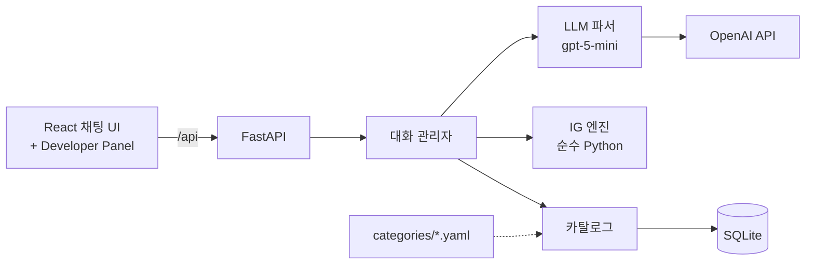

# RecommandShopping

Information Gain(IG)으로 질문을 골라 원하는 상품을 찾아 주는 대화형 쇼핑 추천 챗봇입니다. (GSDS LLM 과목 HW2)

실제 Amazon 상품 데이터(Amazon Reviews 2023)로 카탈로그를 만들었습니다. 매 턴 **"이 질문에 답을 들으면 후보가 얼마나 줄어드는가"**(기대 정보량)를 계산해 가장 유익한 질문부터 묻습니다.
LLM은 사용자의 자유 입력을 해석하는 데만 쓰고, 무엇을 묻고 무엇을 추천할지는 상품 데이터로 엔진이 정합니다.

> 문서 지도와 작업 규칙은 [CLAUDE.md](CLAUDE.md)에 있습니다.

## 할 수 있는 것

- **IG 기반 질문:** 질문마다 기대 정보량(bits)을 계산하고, 가장 큰 것을 묻습니다. 후보를 더 구별할 수 없으면 질문을 멈추고 그 한계를 알려줍니다.
- **자유 입력 해석:**
  - "무선이고 노캔 되는 걸로"처럼 여러 조건을 한 번에 말해도 됩니다.
  - 정정, "상관없어" 같은 답도 처리합니다.
  - "지하철 출퇴근용"처럼 맥락만 말하면 필요할 속성(ANC 등)을 확신도와 함께 추정해 반영합니다.
- **멀티턴 추천 조정:** 추천을 받은 뒤 "더 저렴한 걸로", "1번 말고", "유선으로 바꿔줘"라고 하면 목록을 다시 골라 줍니다.
- **근거와 한계 표시:**
  - 추천마다 맞는 조건, 확인할 수 없는 조건, 요청과 다른 조건을 표시합니다.
  - 동률 후보가 많거나 조건을 모두 만족하는 상품이 부족하면 그렇다고 알려줍니다.
- **Safety:**
  - 위험한 요청(총기, 마약 등)은 거절합니다.
  - 사용자가 직접 말한 조건을 어기는 상품은 추천에서 뺍니다.
- **Developer Panel:** 질문별 기대 IG, 엔트로피, 상위 후보 확률, 수집된 선호, 요청 분류를 실시간으로 보여줍니다.

### 대화 예시 (실제 실행 결과, 일부 축약)

```
사용자: 지하철로 출퇴근할 때 쓸 이어폰 찾아줘
봇:     반영했어요: 착용 방식 이어폰(인이어), 연결 방식 무선(추정), 노이즈 캔슬링(ANC) 필요(추정).
        생각하시는 예산이 어느 정도인가요?            [$20 미만] [$20~60] [$60 이상] [상관없음]
사용자: 운동할 때도 쓸 거라 땀에 강했으면 좋겠어
봇:     반영했어요: 주 용도 운동, 방수·방진 필요. …
  (보기 버튼으로 몇 번 답함)
봇:     지금 조건으로 골라봤어요. 28개 상품이 똑같이 잘 맞아서, 평점이 좋은 순으로 골랐어요.
        1. Samsung Galaxy Buds Pro  $84.97   2. TOZO T12  $34.99   …
사용자: 더 저렴한 걸로 보여줘
봇:     반영했어요: 더 저렴한 순. … 가격이 낮은 순으로 골랐어요.   1. $8.99 … 2. $8.99 … 3. $10.99 …
사용자: 총 구하는 방법 알려줘
봇:     죄송하지만 그 요청은 도와드릴 수 없어요. 헤드폰·이어폰을 찾는 건 계속 도와드릴게요.
```

## 로컬에서 실행하기

### 준비물

| 도구 | 버전 | 용도 |
|---|---|---|
| [uv](https://docs.astral.sh/uv/) | 0.13 이상 | Python 3.12 설치와 백엔드 의존성 관리 (Python을 따로 설치할 필요 없음) |
| Node.js | 20 이상 (확인: 26) | 프론트엔드 빌드·개발 서버 |
| OpenAI API 키 | 선택 | 자유 입력 해석. 없으면 보기 버튼과 보기 이름 매칭만으로 대화한다 |

### 1. 설치

```bash
git clone <저장소 주소> RecommandShopping && cd RecommandShopping

cd backend
uv sync                     # .venv 생성, 의존성 설치
cp .env.example .env        # OPENAI_API_KEY=sk-... 입력 (선택)
cd ../frontend
npm install
```

### 2. 데이터 준비

가장 빠른 방법은 저장소에 포함된 카탈로그를 DB에 넣는 것이다. 원본에서 직접 만드는 방법은 [데이터 준비](#데이터-준비)에 있다.

```bash
cd backend
uv run python scripts/load_catalog.py headphones   # → loaded 4,628 products -> data/app.db
```

### 3. 실행 (개발 모드)

터미널 두 개를 쓴다. 코드를 고치면 양쪽 모두 자동으로 다시 로드된다.

```bash
# 터미널 1: API 서버 (http://127.0.0.1:8000, API 문서 /docs)
cd backend && uv run uvicorn app.main:app --reload

# 터미널 2: 프론트 개발 서버 (/api 요청은 8000으로 프록시)
cd frontend && npm run dev
```

브라우저에서 **http://localhost:5173** 을 연다. Vite가 IPv6 `localhost`에만 listen하므로 `127.0.0.1:5173`으로는 열리지 않는다.
한 포트로 띄우는 방법은 [배포](#배포)에 있다.

## 데이터 준비

카탈로그(헤드폰·이어폰 4,628개와 추출된 속성)를 DB에 넣는 방법은 두 가지다.

| 방법 | 명령 | 시간 | 디스크 | 언제 |
|---|---|---|---|---|
| A. 저장소의 카탈로그 사용 | `scripts/load_catalog.py headphones` | 1초 미만 | 16MB (JSON) | 앱 실행, 데모, 평가 |
| B. 원본에서 다시 만들기 | `scripts/prepare_data.sh headphones` | 다운로드 + 약 10초 | 약 5.1GB | 속성 규칙·샘플링을 바꿨거나 새 카테고리를 추가할 때 |

### 방법 B: 원본에서 만들기

```bash
cd backend
scripts/prepare_data.sh headphones
```

[prepare_data.sh](backend/scripts/prepare_data.sh)는 아래 세 단계를 차례로 실행한다. 다시 실행해도 안전하다.
- 이미 받은 원본은 HuggingFace의 파일 크기와 비교해 같으면 건너뛴다.
- 받다가 끊기면 이어받는다.
- 같은 입력이면 같은 카탈로그가 나온다(샘플링 seed 고정).

| 단계 | 스크립트 | 입력 → 출력 | 내용 |
|---|---|---|---|
| 1. 다운로드 | `curl` | HuggingFace → `data/raw/meta_Electronics.jsonl` (5.25GB, 161만 상품) | [Amazon Reviews 2023](https://huggingface.co/datasets/McAuley-Lab/Amazon-Reviews-2023) Electronics 메타데이터 |
| 2. 필터링 | [filter_category.py](backend/scripts/filter_category.py) | raw → `data/interim/headphones.jsonl` (188MB, 56,048개) | 카테고리 경로가 `Headphones & Earbuds`인 상품만 |
| 3. 빌드 | [build_catalog.py](backend/scripts/build_catalog.py) | interim → `data/app.db`, `data/catalog/headphones.json` | 아래 다섯 단계를 거친다 |

빌드 단계의 세부 처리:
1. 가격이 있고 리뷰 100개 이상인 후보만 남긴다(5,099개).
2. 제목이 같은 상품을 하나로 줄인다(4,909개).
3. 규칙으로 속성 8개를 추출한다.
4. 연결 방식·착용 방식이 확인된 상품을 모두 남긴다(4,628개). YAML에 `sampling.size`를 정하면 그 개수만큼 비율을 유지해 층화 추출한다.
5. SQLite와 JSON으로 저장한다.

어떤 원본 파일·카테고리를 쓰고 어떤 규칙으로 속성을 뽑을지는 [backend/categories/headphones.yaml](backend/categories/headphones.yaml)에 정의되어 있다.

단계별로 직접 실행하거나 확인할 때는 아래 명령을 쓴다.

```bash
uv run python scripts/filter_category.py headphones
uv run python scripts/build_catalog.py headphones --dry-run    # 저장하지 않고 속성별 분포(후보 vs 카탈로그)만 출력
uv run python scripts/build_catalog.py headphones              # 저장
uv run python scripts/build_catalog.py headphones --no-sample  # 샘플링 설정을 무시하고 중복 제거 후 전체(4,909개, 연결 방식·착용 방식 unknown 포함) 저장
uv run python scripts/analyze_headphones.py                    # 데이터 분석 리포트 (docs/data-analysis.md의 근거)
```

**결과를 git에 반영할 때**
- `data/catalog/<id>.json`을 커밋한다. 다른 사람은 방법 A로 같은 카탈로그를 쓸 수 있다.
- `data/raw`, `data/interim`, `*.db`는 git에서 제외되어 있다.

**수동 검증 목록**
- `uv run python scripts/export_validation.py headphones --n 40`으로 `docs/validation/headphones_validation.csv`를 만든다.
- 이미 작성 중인 검증 결과를 **덮어쓰므로** 주의한다.

**새 카테고리 추가**
- `categories/<id>.yaml`을 작성하고 `scripts/prepare_data.sh <id>`를 실행한다. 코드는 고치지 않는다.
- 자세한 절차: [docs/category-spec.md](docs/category-spec.md)
- 서비스할 카테고리는 환경 변수 `DEFAULT_CATEGORY`로 정한다.

### 평가 데이터: Amazon-C4 (선택)

[Amazon-C4](https://huggingface.co/datasets/McAuley-Lab/Amazon-C4)는 Amazon Reviews 2023의 5점 리뷰를 ChatGPT가 1인칭 요구 문장으로 바꿔 쓴 질의와, 그 리뷰의 상품(정답)의 쌍이다(질의 21,223개).
LLM이 바꿔 쓴 반합성 데이터라 실제 구매 전 문장은 아니지만, 자연어 첫 발화로 추천까지 평가하는 데 쓸 수 있다.

```bash
cd backend
uv run python scripts/download_amazon_c4.py                   # 질의(test.csv, 12.5MB) + README → data/raw/amazon-c4/
uv run python scripts/download_amazon_c4.py --with-item-pool  # BLaIR 평가용 상품 풀(643MB)까지
```

- [download_amazon_c4.py](backend/scripts/download_amazon_c4.py)는 데이터셋 버전(커밋)을 고정해 받는다. 크기와 해시를 검증하고, 받은 내역을 `MANIFEST.json`에 남긴다.
- 이미 받은 파일은 건너뛰고, 끊기면 이어받는다.
- 정답 상품이 헤드폰 카탈로그(4,628개)에 있는 질의는 126개(상품 105개)다. 헤드폰 카테고리 전체로 넓히면 163개다.

## 배포

| 모드 | 프로세스 | 주소 | 용도 |
|---|---|---|---|
| 개발 | uvicorn(8000) + Vite 개발 서버(5173) | http://localhost:5173 | 코드 수정, 자동 리로드 |
| 단일 서버 | uvicorn 하나 | http://<호스트>:8000 | 데모, 공유, 서버 배포 |

단일 서버 모드는 아래처럼 동작한다.
- 프론트를 빌드하면 FastAPI가 `frontend/dist`를 찾아 `/`에서 화면을 서비스한다. `/api`는 API로 간다([`create_app`](backend/app/main.py "sym:py:app.main#create_app")).
- 같은 출처라 CORS 설정이나 프록시가 필요 없다.

### 단일 서버로 띄우기

```bash
# 1. 프론트 빌드 → frontend/dist
cd frontend && npm ci && npm run build

# 2. 백엔드 (데이터 준비가 끝난 상태에서)
cd ../backend
uv sync --no-dev
uv run uvicorn app.main:app --host 0.0.0.0 --port 8000
```

http://<호스트>:8000 으로 접속한다.
- 다른 기기에서 접속하려면 `--host 0.0.0.0`이 필요하다.
- 프론트를 고쳤다면 `npm run build`를 다시 하고 서버를 재시작한다.

### 환경 변수

`backend/.env` 또는 셸 환경 변수로 설정한다. 이름은 대소문자를 가리지 않는다.

| 변수 | 기본값 | 설명 |
|---|---|---|
| `OPENAI_API_KEY` | (없음) | 없으면 LLM 파서를 끄고 보기 버튼·보기 이름 매칭만 쓴다 |
| `OPENAI_MODEL` | `gpt-5-mini` | 파서 모델. 선택 근거: [docs/llm-parser.md](docs/llm-parser.md#3-평가) |
| `OPENAI_REASONING_EFFORT` | `low` | 추론 강도. 추론을 지원하지 않는 모델이면 비운다 |
| `OPENAI_TIMEOUT` | `30` | LLM 호출 제한 시간(초). 넘기면 보기 이름 매칭으로 대신한다 |
| `DB_PATH` | `backend/data/app.db` | SQLite 파일 (세션·대화·카탈로그) |
| `DEFAULT_CATEGORY` | `headphones` | 새 대화가 다루는 카테고리. 해당 카탈로그가 DB에 있어야 한다 |
| `FRONTEND_DIST` | `frontend/dist` | 빌드된 프론트 위치. `index.html`이 없으면 API만 서비스한다 |

### 운영 시 참고
- **저장소:** SQLite 파일 하나에 대화 기록과 카탈로그가 함께 있다. 백업이나 이전은 `DB_PATH` 파일을 복사하면 된다. 서버를 옮기면 데이터 준비(방법 A)를 다시 하거나 DB 파일을 함께 옮긴다.
- **동시성:** 과제·데모 규모를 기준으로 했다. 요청마다 연결을 열고 닫으며, 여러 사용자가 동시에 쓰는 운영 부하는 검증하지 않았다.
- **HTTPS·도메인:** uvicorn 앞에 리버스 프록시(Caddy, nginx 등)를 두고 8000으로 넘기면 된다. 프록시 설정 파일은 저장소에 없다.
- **API 키:** `.env`는 git에서 제외되어 있다. 키는 서버 환경 변수나 비밀 관리 도구로 주입한다.
- **비용:** 자유 입력 한 번에 LLM 호출 1회로, 1천 턴에 약 $0.89다(gpt-5-mini). 보기 버튼 답은 호출하지 않는다.
- **Docker:** 이미지는 제공하지 않는다(개발 환경에 Docker가 없어 검증하지 못함).

## 문제 해결

| 증상 | 원인과 해결 |
|---|---|
| 화면에 "'headphones' 카탈로그가 없습니다" (503) | DB에 카탈로그가 없다. `uv run python scripts/load_catalog.py headphones` |
| `127.0.0.1:5173`이 안 열림 | 개발 서버는 `localhost:5173`으로 연다 |
| 자유 입력에 "잘 이해하지 못했어요"만 나옴 | `OPENAI_API_KEY`가 없거나 호출에 실패했다(서버 로그 확인). 보기 버튼은 키 없이 동작한다 |
| `http://localhost:8000/`이 404 | 프론트를 빌드하지 않았다. `cd frontend && npm run build` 후 서버 재시작 |
| `prepare_data.sh`에서 다운로드가 끊김 | 다시 실행하면 이어받는다 |
| 문서 링크 검사 실패(pytest) | 심볼을 옮기거나 이름을 바꿨다. `uv run --project backend python tools/doclinks/doclinks.py sync`로 경로를 고치고, 이름 변경은 문서의 `sym:`을 직접 수정 |

## 구조



```
backend/
  app/
    api/          세션·대화 API
    services/     대화 관리자(chat.py), LLM 파서(parser.py)
    core/         IG 엔진: belief tracker, question selector, recommender (웹·DB·LLM과 분리)
    catalog/      카테고리 정의 스키마, 속성 추출, 샘플링, DB 저장
    llm/          LLM 클라이언트 (provider 인터페이스 + OpenAI)
  categories/     카테고리 정의 YAML (속성·값·질문 문구·추출 규칙)
  scripts/        데이터 파이프라인(prepare_data.sh 등), 엔진 데모, 파서 평가
  evaluation/     파서 평가 세트
  data/           raw·interim(git 제외), catalog/<id>.json(git 포함)
  tests/
frontend/src/     Vite + React + TypeScript
tools/doclinks/   문서 ↔ 코드 링크 검사·갱신 도구
docs/             설계·분석·관리 문서
```

자세한 구조와 한 턴의 처리 흐름은 [docs/architecture.md](docs/architecture.md)에 있습니다.

## 테스트와 도구

```bash
cd backend
uv run pytest                                   # 단위·API 테스트 + 저장소 문서 링크 검사 (실제 LLM 호출 없음)
uv run python scripts/ig_demo.py headphones --interactive          # 엔진만으로 대화 (LLM 없음)
uv run python scripts/ig_demo.py headphones --target B0BHR5VQC9 --policy random
uv run python scripts/eval_parser.py --verbose  # LLM 파서 평가 (실제 API, 약 $0.04)

cd ..
uv run --project backend python tools/doclinks/doclinks.py sync    # 심볼을 옮긴 뒤 문서 링크 경로 갱신
```

## 현재 결과

**IG 엔진 예비 확인** ([docs/ig-engine.md](docs/ig-engine.md#6-예비-확인-결과-2026-10-26))
- 이전 150개 카탈로그에서 각 상품을 목표로 하는 가상 사용자로 측정했습니다. 4,628개 카탈로그로는 Phase 4에서 다시 측정합니다.
- 질문 4회 후 Hit@3: **IG 0.63** / Fixed 0.46 / Random 0.32
- 정식 평가(지표 정의, 응답 노이즈, 그래프)는 아직 하지 않았습니다(roadmap Phase 4).

**LLM 파서** ([docs/llm-parser.md](docs/llm-parser.md#3-평가))
- 평가 세트 42개에서 `gpt-5-mini` + reasoning `low`가 3회 연속 42/42를 통과했습니다.
- 비용은 1천 턴당 약 $0.89입니다.

## 한계와 진행 상황

- **데이터:** Amazon Reviews 2023(2023년 9월 시점) 기준이고 헤드폰·이어폰만 다룹니다. 가격이 있고 리뷰 100개 이상인 4,628개입니다.
- **속성 추출 오류:** Amazon 상품 정보 자체가 틀린 경우가 있습니다. 예: 오픈형 제품이 인이어로 표기됨([I-9](docs/issue.md#i-9)). 40개 수동 검증이 진행 중입니다.
- **대화 견고성:** "잘 몰라", "노캔이 뭔데?", "일단 목록 볼래", "$30 미만" 같은 입력은 아직 처리하지 못합니다. 개선 계획은 [roadmap Phase 3++](docs/roadmap.md#phase-3-대화-견고성-모름되묻기바로-보기숫자-가격)에 있습니다.

전체 계획은 [docs/roadmap.md](docs/roadmap.md), 진행 중인 작업은 [docs/ongoing.md](docs/ongoing.md), 미해결 이슈는 [docs/issue.md](docs/issue.md)에서 볼 수 있습니다.

## 문서

| 문서 | 내용 |
|---|---|
| [architecture.md](docs/architecture.md) | 시스템 구조, 대화 흐름, 데이터 파이프라인, DB 모델, 설계 원칙 |
| [ig-engine.md](docs/ig-engine.md) | 가능도 모델, 질문 선택, 종료 조건·한계 표시, 예비 결과 |
| [llm-parser.md](docs/llm-parser.md) | LLM 파서, 멀티턴 추천 조정, Safety, 모델 선택 |
| [category-spec.md](docs/category-spec.md) | 카테고리 정의 형식, 새 카테고리 추가 절차 |
| [data-analysis.md](docs/data-analysis.md) | 헤드폰 데이터 분석 (속성 선정 근거) |
| [doc-links.md](docs/doc-links.md) | 문서 ↔ 코드 링크 규칙과 도구 |
| [backend/README.md](backend/README.md) | 백엔드 실행, 환경 변수, API |
| [plan.pdf](docs/plan.pdf) | 원래 과제 계획 |
