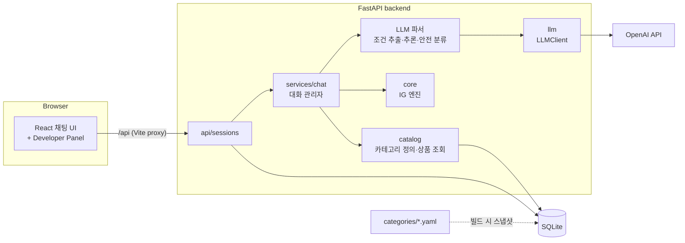
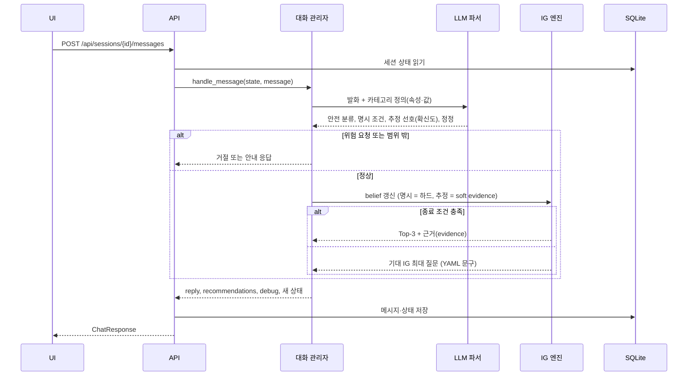
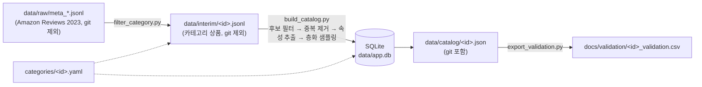
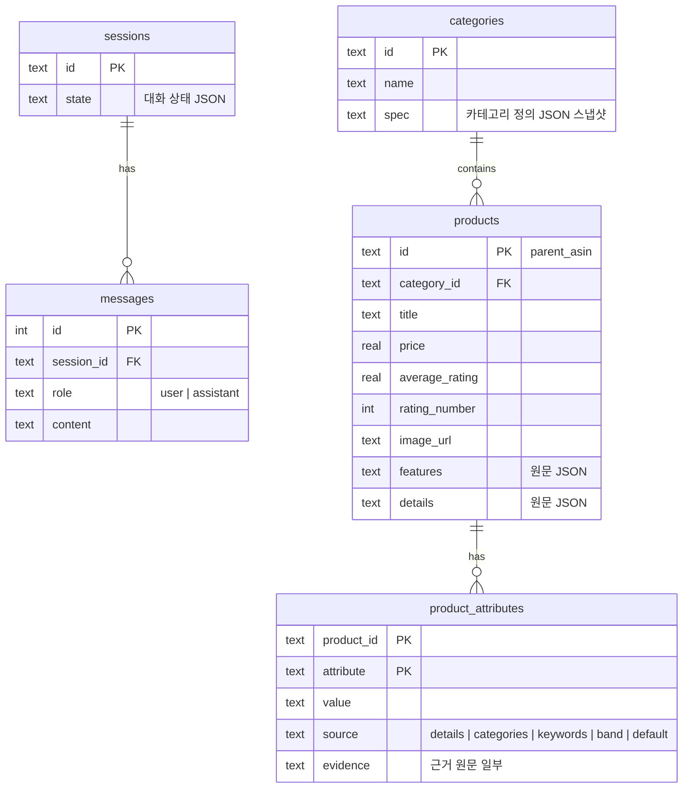

# 시스템 아키텍처

← [CLAUDE.md](../CLAUDE.md) · 관련: [roadmap](roadmap.md) · [카테고리 정의](category-spec.md) · [데이터 분석](data-analysis.md) · [문서↔코드 링크](doc-links.md)

Information Gain(IG) 기반 대화형 상품 추천 챗봇의 구조. 각 구성 요소의 상태는 다음과 같이 표시한다.

- ✅ 구현됨
- 🚧 골격만 있음 (stub)
- 📝 설계만 있음 (예정)

## 1. 한눈에 보기



| 구성 요소 | 위치 | 역할 | 상태 |
|---|---|---|---|
| 채팅 UI | [`App`](../frontend/src/App.tsx "sym:ts:src/App#App"), [`DebugPanel`](../frontend/src/components/DebugPanel.tsx "docid:ui.debug-panel"), [`sendMessage`](../frontend/src/api.ts "docid:ui.send-message") | 대화, Top-3 추천 표시, Developer Panel(선택 속성·기대 IG·후보 확률) | ✅ |
| 세션 API | [`post_message`](../backend/app/api/sessions.py "sym:py:app.api.sessions#post_message") ([sessions.py](../backend/app/api/sessions.py)) | 세션 생성, 대화 기록, 메시지 처리 | ✅ |
| 대화 관리자 | [`handle_message`](../backend/app/services/chat.py "docid:chat.handle-turn") | 한 턴의 처리 순서를 조율 ([3절](#3-대화-한-턴의-흐름)). 답 반영 → 엔진 결정 → 질문(보기 포함)·추천(근거·한계 문장) 응답 | ✅ 버튼 답 + 보기 문자열 매칭 / 📝 자연어 파싱 |
| LLM 클라이언트 | [`LLMClient`](../backend/app/llm/base.py "docid:llm.client"), [`OpenAIClient`](../backend/app/llm/openai_client.py "sym:py:app.llm.openai_client#OpenAIClient"), [`get_llm_client`](../backend/app/llm/__init__.py "sym:py:app.llm#get_llm_client") | provider 공통 인터페이스 `complete` / `parse`, OpenAI 구현 | ✅ |
| LLM 파서 | [`parse_message`](../backend/app/services/parser.py "docid:chat.parse-message") ([LLM 파서 문서](llm-parser.md)) | 발화 → 요청 분류(Safety), 명시 조건·추정 선호·정정, 추천 조정(제외, 가격 정렬) | ✅ |
| IG 엔진 | [`IGEngine`](../backend/app/core/engine.py "docid:core.engine"), [`PreferenceState`](../backend/app/core/model.py "docid:core.preference-state") ([IG 엔진 문서](ig-engine.md)) | belief tracker, question selector(IG/Random/Fixed), recommender, 종료·한계 판단 | ✅ (대화 API 연결은 Phase 3) |
| 카탈로그 | [`CategorySpec`](../backend/app/catalog/spec.py "sym:py:app.catalog.spec#CategorySpec"), [`extract_attributes`](../backend/app/catalog/extract.py "sym:py:app.catalog.extract#extract_attributes"), [`stratified_sample`](../backend/app/catalog/sampling.py "sym:py:app.catalog.sampling#stratified_sample"), [`load_products`](../backend/app/catalog/repository.py "sym:py:app.catalog.repository#load_products") | 카테고리 정의 검증, 속성 추출, 샘플링, DB 저장·조회 | ✅ |
| 데이터 스크립트 | [`build_catalog`](../backend/scripts/build_catalog.py "sym:py:scripts.build_catalog"), [`filter_category`](../backend/scripts/filter_category.py "sym:py:scripts.filter_category") | 원본 → 카탈로그 오프라인 파이프라인 ([4절](#4-데이터-파이프라인-오프라인)) | ✅ |
| 평가 | (예정) `backend/evaluation/` | Synthetic user, Random/Fixed/IG 비교 | 📝 |

## 2. 설계 원칙

1. **카테고리별 코드를 만들지 않는다.**
   - 속성, 값, 질문 문구, 추출 규칙은 [카테고리 정의 YAML](category-spec.md)에만 둔다.
   - 추출, IG 엔진, LLM 파서 프롬프트는 이 정의를 읽어 동작한다.
   - 새 카테고리 추가는 YAML 파일 하나로 끝난다.
2. **IG 엔진은 웹·DB·LLM과 분리된 순수 Python이다.**
   - 같은 코드를 API와 평가 시뮬레이터가 함께 쓴다.
   - 그래서 평가 결과가 실제 서비스 동작과 같다.
3. **LLM은 해석만 하고, 결정은 엔진이 한다.**
   - LLM은 발화를 구조화된 조건으로 바꾼다.
   - 무엇을 물을지, 무엇을 추천할지는 IG 엔진이 상품 데이터로 정한다.
   - LLM이 상품 속성을 지어내지 않게 하기 위함이다(Safety, 환각 방지).
4. **추정은 belief를 고치고 IG는 건드리지 않는다.**
   - 맥락에서 추정한 선호는 확신도만큼만 반영하는 약한 증거로 belief에 넣는다.
   - 질문 우선순위는 갱신된 belief에서 다시 계산되어 자연히 바뀐다. 반반이던 속성은 IG가 내려가고, 드문 값의 속성은 반반에 가까워져 IG가 올라 확인 질문이 앞선다([IG 엔진 3절](ig-engine.md#3-질문-선택)).
   - 자세한 내용: [roadmap Phase 3+](roadmap.md#phase-3-기능-고도화-암묵적-선호-추론과-추천-보정)
5. **모르는 것은 unknown으로 둔다.**
   - 근거 없는 속성은 저장하지 않는다(행이 없으면 unknown).
   - 애매한 언급은 기본값으로 단정하지 않는다(`unknown_if`, [`extract_attribute`](../backend/app/catalog/extract.py "sym:py:app.catalog.extract#extract_attribute")).
   - 추천 근거로는 저장된 원문(`evidence`)만 보여준다.
6. **LLM 호출을 최소화한다.**
   - 한 턴에 파서 호출 1회가 원칙이다.
   - 질문 문장은 YAML 템플릿을 쓰고, IG 계산과 시뮬레이션은 로컬에서 한다.
   - 기본 모델은 `gpt-5-mini`, 추론 강도 `low`다. 파서 평가 42개 케이스로 골랐다([LLM 파서 3절](llm-parser.md#3-평가), [I-5](issue.md#i-5)).

## 3. 대화 한 턴의 흐름

전 단계가 구현되어 웹에서 동작한다. 대화 관리자가 LLM 파서와 IG 엔진([`IGEngine.step`](../backend/app/core/engine.py "docid:core.engine-step"))을 호출한다.
- 보기 버튼을 누르면 `answer`를 그대로 쓴다. 이때는 LLM을 부르지 않는다.
- 자유 입력은 LLM 파서로 해석한다. 키가 없거나 호출이 실패하면 보기 이름 문자열 매칭([`match_text`](../backend/app/services/chat.py "sym:py:app.services.chat#match_text"))으로 대신한다.
- 추천을 보여준 뒤에도 대화가 이어진다. 조건 추가·변경, "1번 말고", "더 싼 걸로"로 추천을 조정한다([LLM 파서 6절](llm-parser.md#6-멀티턴-추천-조정)).



1. **상태 읽기:** 세션 상태 JSON을 SQLite에서 읽는다([`_load_state`](../backend/app/api/sessions.py "sym:py:app.api.sessions#_load_state")) ✅
2. **파싱:** LLM 1회 호출로 아래를 함께 받는다. 출력 스키마는 카테고리 정의에서 자동 생성한다 ✅ ([LLM 파서](llm-parser.md#2-파서))
   - 안전 분류
   - 명시 조건과 정정
   - 추정 선호(확신도 포함)
3. **Safety** ✅ ([LLM 파서 5절](llm-parser.md#5-요청-분류와-safety))
   - 위험 요청(총기류, 마약류 등)은 거절한다. 상태는 바꾸지 않는다.
   - 서비스 범위 밖 요청은 안내 응답을 한다.
   - [roadmap 확정 결정사항](roadmap.md#확정된-결정사항) 참고
4. **belief 갱신:** 처리 순서는 다음과 같다 ✅ 엔진 ([가능도 모델](ig-engine.md#1-답변-가능도-모델))
   - 명시 조건은 해당 값과 맞지 않는 상품의 확률을 크게 낮춘다(확신도 1−ε).
   - 추정 선호는 확신도만큼만 반영한다.
   - 정정이 있으면 모든 조건으로 belief를 처음부터 다시 계산한다.
5. **종료 판단:** 아래 중 하나면 추천한다 ✅ 엔진 ([종료 조건](ig-engine.md#4-추천과-한계-표시))
   - Top-3 확률 합이 임계값(0.9) 이상
   - 질문 예산(4회) 소진
   - 남은 질문의 기대 IG가 모두 0.05 bits 미만(후보 구별 불가). 이때 구별 못 한 후보 수 등 한계를 함께 돌려준다
6. **응답 생성** ✅ 템플릿 (질문은 YAML 문구 + 보기, 추천은 근거·한계 문장. LLM 문장 생성은 하지 않음)
   - 추천일 때: Top-3와 근거를 보여준다. 명시 조건을 어기는 상품은 빼서 사용자 요구와 무관한 추천을 막는다(Safety 1).
   - 질문일 때: `askable` 속성 중 기대 IG가 최대인 것을 묻는다.
7. **상태 저장:** 메시지와 상태를 저장하고 `debug`([`DebugInfo`](../backend/app/schemas.py "sym:py:app.schemas#DebugInfo"): 선택 속성, 질문별 기대 IG, 엔트로피, 종료 이유, 상위 후보, 수집된 선호)를 함께 반환한다 ✅

### 세션 상태
`sessions.state`에 JSON으로 저장한다. belief는 저장하지 않고, 조건 목록에서 매번 다시 계산한다.
이렇게 하면 정정 처리가 단순해지고 상태와 belief가 어긋나지 않는다.
[`ChatState`](../backend/app/services/chat.py "sym:py:app.services.chat#ChatState")가 저장 형식이다 ✅.
- `preference`: [`PreferenceState`](../backend/app/core/model.py "docid:core.preference-state")
- `pending`: 지금 답을 기다리는 질문
- `finished`: 추천 완료 여부

```json
{
  "category_id": "headphones",
  "turn": 3,
  "preference": {
    "explicit": {"use_case": "sports"},
    "inferred": {"anc": {"value": "yes", "confidence": 0.8, "reason": "지하철 통학"}},
    "dont_care": ["price_band"],
    "asked": ["use_case", "price_band", "form_factor"]
  },
  "pending": "form_factor",
  "finished": false
}
```

## 4. 데이터 파이프라인 (오프라인)



- 스크립트 사용법과 YAML 형식: [카테고리 정의](category-spec.md#새-카테고리-추가-절차)
- 헤드폰 데이터의 근거 수치: [데이터 분석](data-analysis.md)
- 현재 카탈로그: 헤드폰·이어폰 4,628개. 가격이 있고 리뷰 100개 이상이며, 연결 방식·착용 방식이 확인된 후보 전체다. 처음엔 150개 층화 추출이었으나 조건 조합 공백 때문에 확대했다([done](done.md)).

## 5. 데이터 모델 (SQLite)

스키마: [`SCHEMA`](../backend/app/db.py "sym:py:app.db#SCHEMA") ([db.py](../backend/app/db.py))



- **`product_attributes`:** 카테고리와 무관한 key-value 형태다. 행이 없으면 unknown이다.
- **`categories.spec`:** 카탈로그를 빌드할 때 YAML 정의를 함께 저장한다([`save_category`](../backend/app/catalog/repository.py "sym:py:app.catalog.repository#save_category")). 런타임은 이 스냅샷을 읽으므로, DB 안의 상품 속성과 정의의 버전이 항상 일치한다.

## 6. 외부 의존성과 설정

| 항목 | 내용 | 설정 |
|---|---|---|
| OpenAI API | 파서·추론용 LLM. 키가 없어도 서버는 뜨고, 호출할 때만 에러 | `backend/.env` ([backend README](../backend/README.md#환경-변수)) |
| Amazon Reviews 2023 | 상품 메타데이터 원본 | [데이터 분석](data-analysis.md) |
| 실행 | backend :8000, frontend :5173 (`/api` 프록시) | [CLAUDE.md 실행](../CLAUDE.md#실행) |

## 7. 평가 구조 (📝 예정)

- IG 엔진(`core`)을 직접 import해 웹 없이 돌린다. 세 질문 정책은 구현되어 있다 ✅. [예비 확인 결과](ig-engine.md#6-예비-확인-결과-2026-10-26)
- Synthetic user가 숨겨진 선호에 따라 답한다.
- Random / Fixed / IG는 질문 선택 방법만 다르고, 나머지(카탈로그, 초기 확률, 응답, 추천기)는 같다.
- 지표: Hit@1, Hit@3, Turn-AUC, 조건 충족률 ([roadmap Phase 4](roadmap.md#phase-4-정량-평가), 정의 미정 [I-4](issue.md#i-4))
