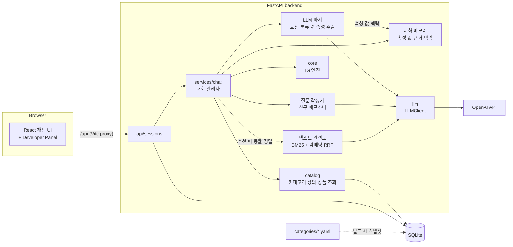
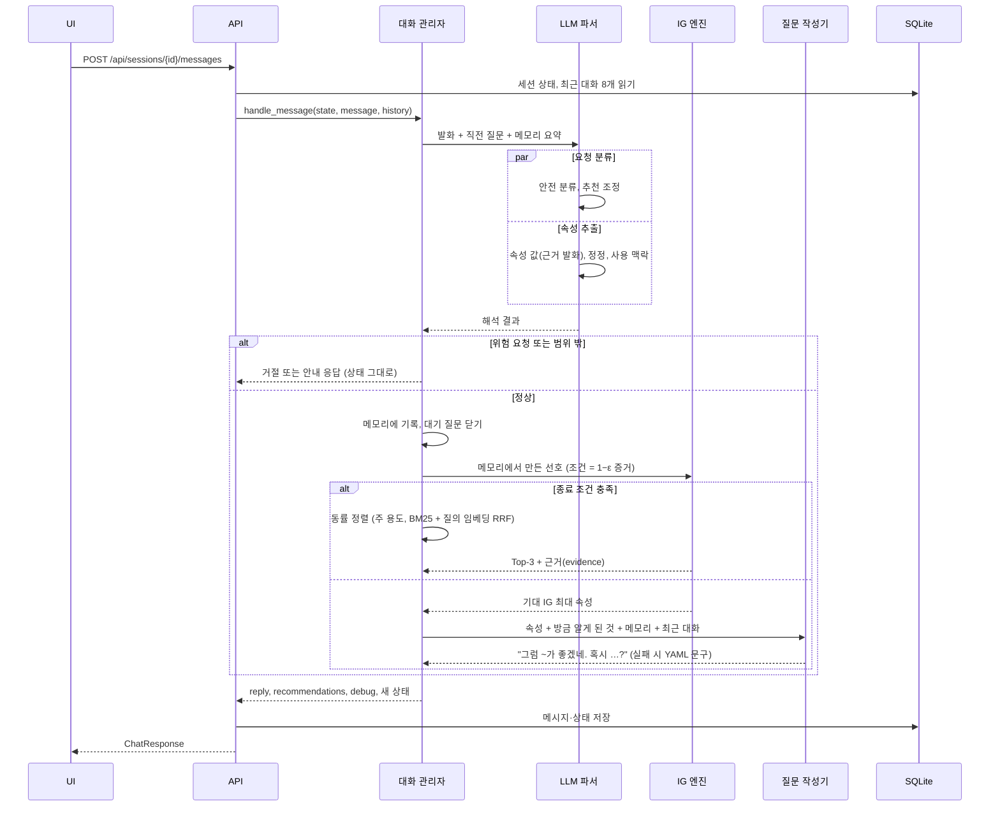
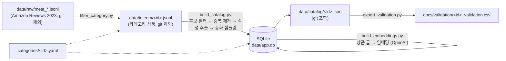
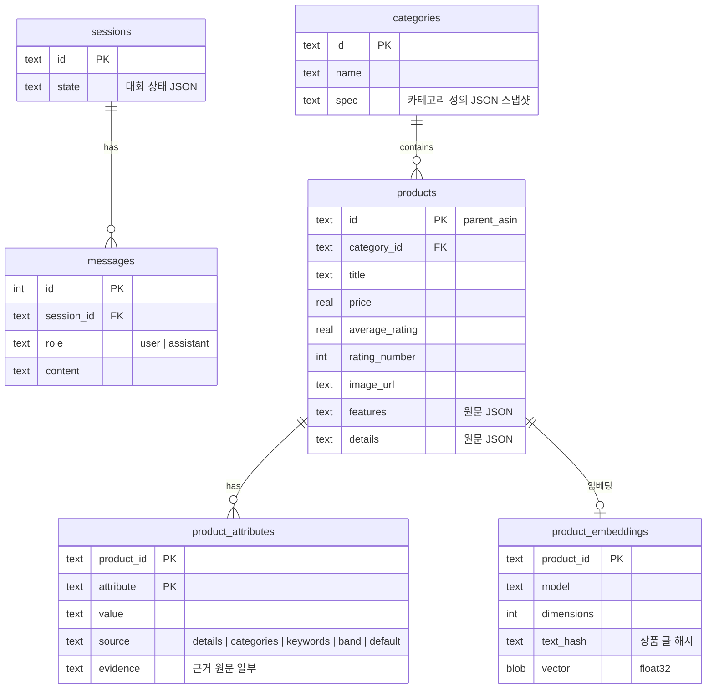

# 시스템 아키텍처

← [CLAUDE.md](../CLAUDE.md) · 관련: [roadmap](roadmap.md) · [카테고리 정의](category-spec.md) · [데이터 분석](data-analysis.md) · [문서↔코드 링크](doc-links.md)

Information Gain(IG) 기반 대화형 상품 추천 챗봇의 구조. 각 구성 요소의 상태는 다음과 같이 표시한다.

- ✅ 구현됨
- 🚧 골격만 있음 (stub)
- 📝 설계만 있음 (예정)

## 1. 한눈에 보기



| 구성 요소 | 위치 | 역할 | 상태 |
|---|---|---|---|
| 채팅 UI | [`App`](../frontend/src/App.tsx "sym:ts:src/App#App"), [`DebugPanel`](../frontend/src/components/DebugPanel.tsx "docid:ui.debug-panel"), [`sendMessage`](../frontend/src/api.ts "docid:ui.send-message") | 대화, 보기 버튼, Top-3 추천 표시, Developer Panel(선택 속성·기대 IG·후보 확률·메모리·질문 접근) | ✅ |
| 세션 API | [`post_message`](../backend/app/api/sessions.py "sym:py:app.api.sessions#post_message") ([sessions.py](../backend/app/api/sessions.py)) | 세션 생성, 대화 기록, 메시지 처리 | ✅ |
| 대화 관리자 | [`handle_message`](../backend/app/services/chat.py "docid:chat.handle-turn") | 한 턴을 해석 → 상태 갱신 → 결정 → 표현으로 처리 ([3절](#3-대화-한-턴의-흐름)) | ✅ |
| 대화 상태 | [`ChatState`](../backend/app/services/state.py "sym:py:app.services.state#ChatState") | 메모리, 질문 기록, 추천 조정을 저장. 엔진 입력은 저장하지 않고 매 턴 만듦 | ✅ |
| 응답 표현 | [responses.py](../backend/app/services/responses.py) | 추천 근거·한계·안내 문구 템플릿(한국어·영어, 사용자 발화의 언어), 보기 버튼, 고정 질문(대체용) | ✅ |
| 텍스트 관련도 | [`relevance_scores`](../backend/app/services/relevance.py "docid:chat.text-relevance"), [`tie_order`](../backend/app/services/chat.py "docid:chat.tie-order"), [`CatalogSearch`](../backend/app/catalog/search.py "docid:catalog.search") | 조건이 같은 상품 사이를 주 용도 일치 → 대화와 상품 글의 관련도(BM25 + 미리 만든 상품 임베딩, RRF) → 평점 순으로 정렬 ([IG 엔진 4절](ig-engine.md#4-추천과-한계-표시)) | ✅ |
| LLM 클라이언트 | [`LLMClient`](../backend/app/llm/base.py "docid:llm.client"), [`OpenAIClient`](../backend/app/llm/openai_client.py "sym:py:app.llm.openai_client#OpenAIClient"), [`get_llm_client`](../backend/app/llm/__init__.py "sym:py:app.llm#get_llm_client") | provider 공통 인터페이스 `complete` / `parse` / `embed`, OpenAI 구현 | ✅ |
| LLM 파서 | [`parse_message`](../backend/app/services/parser.py "docid:chat.parse-message") ([LLM 파서 문서](llm-parser.md)) | 두 호출을 동시에: 요청 분류(Safety·발화 언어)·추천 조정(제외, 가격 정렬) / 속성 추출([`extract_attributes`](../backend/app/services/extractor.py "docid:chat.extract-attributes"): 속성 값과 근거 발화·정정·사용 맥락·영어 검색 키워드. 결과를 그대로 믿음) | ✅ |
| 대화 메모리 | [`ConversationMemory`](../backend/app/services/memory.py "sym:py:app.services.memory#ConversationMemory") ([LLM 파서 4절](llm-parser.md#4-대화-메모리)) | 대화에서 알아낸 사실의 유일한 기록: 속성 값과 근거 발화, 속성 밖의 사용 맥락. 다음 턴의 추출·질문 맥락 | ✅ |
| 질문 작성기 | [`write_question`](../backend/app/services/questioner.py "docid:chat.write-question") ([LLM 파서 5절](llm-parser.md#5-질문-작성기-친구-페르소나)) | 방금 알게 된 것을 친구처럼 결론으로 말하고, 엔진이 고른 다음 속성을 생활 장면으로 은근히 묻는다. 실패하면 YAML 고정 질문 | ✅ |
| IG 엔진 | [`IGEngine`](../backend/app/core/engine.py "docid:core.engine"), [`PreferenceState`](../backend/app/core/model.py "docid:core.preference-state") ([IG 엔진 문서](ig-engine.md)) | belief tracker, question selector(IG/Random/Fixed), recommender, 종료·한계 판단 | ✅ |
| 카탈로그 | [`CategorySpec`](../backend/app/catalog/spec.py "sym:py:app.catalog.spec#CategorySpec"), [`extract_attributes`](../backend/app/catalog/extract.py "sym:py:app.catalog.extract#extract_attributes"), [`stratified_sample`](../backend/app/catalog/sampling.py "sym:py:app.catalog.sampling#stratified_sample"), [`load_products`](../backend/app/catalog/repository.py "sym:py:app.catalog.repository#load_products") | 카테고리 정의 검증, 속성 추출, 샘플링, DB 저장·조회 | ✅ |
| 데이터 스크립트 | [`build_catalog`](../backend/scripts/build_catalog.py "sym:py:scripts.build_catalog"), [`filter_category`](../backend/scripts/filter_category.py "sym:py:scripts.filter_category"), [build_embeddings.py](../backend/scripts/build_embeddings.py) | 원본 → 카탈로그 오프라인 파이프라인 ([4절](#4-데이터-파이프라인-오프라인)), 상품 임베딩 | ✅ |
| 평가 | [`run_episode`](../backend/app/evaluation/runner.py "docid:eval.run-episode"), [`EvalPanel`](../frontend/src/components/EvalPanel.tsx "docid:ui.eval-panel") ([평가 문서](evaluation.md)) | C4 시나리오, 가상 사용자·LLM 심판, IG/Random/LLM 비교, 평가 모드(매뉴얼·자동) | ✅ |

## 2. 설계 원칙

1. **카테고리별 코드를 만들지 않는다.**
   - 속성, 값, 질문 문구, 추출 규칙은 [카테고리 정의 YAML](category-spec.md)에만 둔다.
   - 추출, IG 엔진, LLM 파서 프롬프트는 이 정의를 읽어 동작한다.
   - 새 카테고리 추가는 YAML 파일 하나로 끝난다.
2. **IG 엔진은 웹·DB·LLM과 분리된 순수 Python이다.**
   - 같은 코드를 API와 평가가 함께 쓴다. 대화 평가는 대화 관리자(`handle_message`)를 그대로 부른다.
   - 그래서 평가 결과가 실제 서비스 동작과 같다.
3. **LLM은 해석과 말하기만 하고, 결정은 엔진이 한다.**
   - LLM은 발화를 구조화된 조건으로 바꾸고, 엔진이 고른 질문을 자연스러운 말로 바꾼다.
   - 무엇을 물을지, 무엇을 추천할지는 IG 엔진이 상품 데이터로 정한다. 조건이 같은 상품 사이의 순서만 대화와 상품 글의 텍스트 관련도(임베딩 포함)로 정한다([IG 엔진 4절](ig-engine.md#4-추천과-한계-표시)).
   - LLM이 있으면 발화의 의미 판정(상관없음 포함)은 LLM만 한다. 단어 목록 같은 규칙으로 덮어쓰지 않는다. 규칙(보기 이름 매칭)은 LLM이 없을 때의 대체 경로뿐이다.
   - LLM이 상품 속성을 지어내지 않게 하기 위함이다(Safety, 환각 방지).
4. **속성 추출 결과는 그대로 믿는다 (2026-10-31).**
   - LLM에게 확신도를 받지 않는다. 추출기가 뽑은 값은 사용자가 직접 말한 것과 같은 조건이 된다.
   - 대신 추출기에는 "값이 분명히 따라 나올 때만 넣으라"고 지시하고, 질문 작성기가 알게 된 것을 결론처럼 말해 사용자가 틀린 것을 바로 정정할 수 있게 한다.
   - 엔진의 1−ε(ε=0.05)는 LLM 확신도가 아니라 "답에도 오차가 있다"는 가능도 모델의 값이라 남긴다.
   - 이전 설계(확신도별 약한 증거)와 바꾼 이유: [roadmap Phase 3+](roadmap.md#phase-3-기능-고도화-암묵적-선호-추론과-추천-보정)
5. **모르는 것은 unknown으로 둔다.**
   - 근거 없는 속성은 저장하지 않는다(행이 없으면 unknown).
   - 애매한 언급은 기본값으로 단정하지 않는다(`unknown_if`, [`extract_attribute`](../backend/app/catalog/extract.py "sym:py:app.catalog.extract#extract_attribute")).
   - 추천 근거로는 저장된 원문(`evidence`)만 보여준다.
6. **LLM 호출은 역할별로 나누고, 기다리는 시간은 줄인다.**
   - 자유 입력 한 턴: 요청 분류와 속성 추출을 동시에(2회), 질문이면 질문 작성 1회. 버튼 답이면 질문 작성만. 추천하는 턴에는 질의 임베딩 1회.
   - 미리 만들 수 있는 것은 미리 만든다. 상품 임베딩은 오프라인으로 만들어 SQLite에 저장하고, BM25·임베딩 색인은 카탈로그가 바뀔 때까지 캐시한다.
   - IG 계산은 로컬에서 한다.
   - 기본 모델은 `gpt-5-mini`, 추론 강도는 해석·질문 작성 모두 `low`([LLM 파서 3절](llm-parser.md#3-평가), [5절](llm-parser.md#5-질문-작성기-친구-페르소나), [I-5](issue.md#i-5)). 응답 시간은 [I-12](issue.md#i-12).

## 3. 대화 한 턴의 흐름

대화 관리자([`handle_message`](../backend/app/services/chat.py "docid:chat.handle-turn"))는 한 턴을 네 단계로 처리한다.

| 단계 | 하는 일 | 코드 |
|---|---|---|
| 1. 해석 | 버튼 답 그대로, 또는 LLM 파서(요청 분류 ∥ 속성 추출). LLM이 없거나 실패하면 보기 이름 매칭([`match_text`](../backend/app/services/chat.py "sym:py:app.services.chat#match_text")) | [`parse_message`](../backend/app/services/parser.py "docid:chat.parse-message") |
| 2. 상태 갱신 | 알아낸 속성 값을 근거 발화와 함께 메모리에 기록, 대기 질문을 닫음(답함 / 답 안 함), 추천 조정(제외·가격 정렬) | [`apply_parsed`](../backend/app/services/chat.py "docid:chat.apply-parsed"), [`ChatState`](../backend/app/services/state.py "sym:py:app.services.state#ChatState") |
| 3. 결정 | 메모리·질문 기록에서 엔진 입력을 만들고([`ChatState.preference`](../backend/app/services/state.py "docid:chat.preference-of"), 조건이 아닌 속성 제외), IG 엔진이 질문 또는 추천을 정함. 추천이면 조건이 같은 상품 사이를 주 용도 일치 → 텍스트 관련도 → 평점 순으로 정렬 | [`IGEngine.step`](../backend/app/core/engine.py "docid:core.engine-step"), [`decide`](../backend/app/services/chat.py "sym:py:app.services.chat#decide") |
| 4. 표현 | 사용자 발화의 언어(한국어·영어)로. 질문은 질문 작성기(방금 알게 된 것을 결론처럼 말하고 다음 질문을 돌려 묻기), 추천·안내는 두 언어 템플릿 | [`write_question`](../backend/app/services/questioner.py "docid:chat.write-question"), [responses.py](../backend/app/services/responses.py) |

- 보기 버튼을 누르면 `answer`를 그대로 쓴다(메모리에도 남긴다). 해석에는 LLM을 부르지 않는다.
- 질문에 답하지 않은 말(잡담, 다른 이야기, 모호한 말)은 혼내지 않는다. 다른 정보가 있으면 반영하고, 같은 속성은 한 번 더 더 직접적으로 묻거나 넘어간다([LLM 파서 6절](llm-parser.md#6-질문에-답하지-않은-말)).
- 추천을 보여준 뒤에도 대화가 이어진다. 조건 추가·변경, "1번 말고", "더 싼 걸로"로 추천을 조정한다([LLM 파서 9절](llm-parser.md#9-멀티턴-추천-조정)).



**세부**
1. **Safety** ✅ ([LLM 파서 8절](llm-parser.md#8-요청-분류와-safety))
   - 위험 요청(총기류, 마약류 등)은 거절한다. 상태는 바꾸지 않는다.
   - 서비스 범위 밖 요청은 안내 응답을 한다. 분류가 쇼핑이 아니면 속성 추출 결과는 버린다.
   - [roadmap 확정 결정사항](roadmap.md#확정된-결정사항) 참고
2. **belief 갱신** ✅ ([가능도 모델](ig-engine.md#1-답변-가능도-모델))
   - 속성 추출기가 뽑은 값도, 버튼 답도 같은 조건이다. 해당 값과 맞지 않는 상품의 확률을 크게 낮춘다(1−ε).
   - 정정하면 메모리의 마지막 값이 이기고, belief는 처음부터 다시 계산한다.
3. **종료 판단** ✅ ([종료 조건](ig-engine.md#4-추천과-한계-표시))
   - Top-3 확률 합이 임계값(0.9) 이상
   - 질문 예산(4개 속성) 소진. 답이 나왔거나 두 번 물어 넘어간 속성을 센다
   - 남은 질문의 기대 IG가 모두 0.05 bits 미만(후보 구별 불가). 이때 구별 못 한 후보 수 등 한계를 함께 돌려준다
4. **응답** ✅
   - 추천: 템플릿. Top-3와 근거를 보여준다. 말한 조건을 어기는 상품은 빼서 사용자 요구와 무관한 추천을 막는다(Safety 1).
   - 질문: 보기 버튼도 함께 보낸다.
5. **반환:** 메시지와 상태를 저장하고 `debug`([`DebugInfo`](../backend/app/schemas.py "sym:py:app.schemas#DebugInfo"): 선택 속성, 질문별 기대 IG, 엔트로피, 종료 이유, 상위 후보, 엔진 입력, 메모리·질문 기록, 질문 출처·접근, 동률 정렬 기준)를 함께 반환한다 ✅

### 세션 상태
`sessions.state`에 JSON으로 저장한다. 형식은 [`ChatState`](../backend/app/services/state.py "sym:py:app.services.state#ChatState")다 ✅.

**사실은 메모리 한 곳에만 기록한다.** 엔진 입력([`PreferenceState`](../backend/app/core/model.py "docid:core.preference-state"))과 belief는 저장하지 않고 매 턴 메모리와 질문 기록에서 만든다.
그래서 같은 사실이 두 곳에서 어긋날 수 없고, 정정은 새 사실을 남기는 것으로 끝난다.

| 항목 | 내용 |
|---|---|
| `memory.facts` | 속성 값 기록 `{attribute, value, quote(근거 발화), turn, source: said\|button}`. 속성별 마지막 값이 조건이 된다 |
| `memory.notes` | 속성 밖의 사용 맥락 (질문 작성기, 텍스트 관련도 질의) |
| `memory.keywords` | 상품 설명 검색용 영어 키워드 (텍스트 관련도의 BM25 질의) |
| `questions` | 속성별 질문 기록 `{text, turn, attempts, status: pending\|answered\|unanswered\|skipped}` |
| `finished`, `last_recommended`, `excluded`, `price_order` | 추천을 보여줬는지, 보여준 추천, 제외한 상품, 가격 정렬 |
| `language` | 사용자에게 보이는 말의 언어(`ko` / `en`). 요청 분류기가 매 턴 발화의 언어로 정한다 |

- 최근 대화는 상태에 두지 않고 `messages` 테이블에서 읽어 질문 작성기에 넘긴다.
- 엔진 입력 만들기: `explicit`/`dont_care`는 속성별 마지막 사실(조건이 아닌 속성 제외), `asked`(다시 묻지 않음 + 예산)는 `unanswered`가 아닌 질문.

```json
{
  "category_id": "headphones",
  "turn": 3,
  "memory": {
    "facts": [{"attribute": "anc", "value": "yes", "quote": "지하철로 통학해", "turn": 1, "source": "said"},
              {"attribute": "price_band", "value": "dont_care", "quote": "상관없음", "turn": 2, "source": "button"}],
    "notes": ["지하철 통학"],
    "keywords": ["commute", "subway", "noise cancelling"]
  },
  "questions": {
    "price_band": {"attribute": "price_band", "text": "예산은 어느 정도 생각해?", "turn": 1, "attempts": 1, "status": "answered"},
    "form_factor": {"attribute": "form_factor", "text": "오래 끼고 있으면 귀가 아픈 편이야?", "turn": 2, "attempts": 1, "status": "pending"}
  },
  "finished": false,
  "last_recommended": [],
  "excluded": [],
  "price_order": null,
  "language": "ko"
}
```

## 4. 데이터 파이프라인 (오프라인)



- 스크립트 사용법과 YAML 형식: [카테고리 정의](category-spec.md#새-카테고리-추가-절차)
- 헤드폰 데이터의 근거 수치: [데이터 분석](data-analysis.md)
- 현재 카탈로그: 헤드폰·이어폰 4,628개. 가격이 있고 리뷰 100개 이상이며, 연결 방식·착용 방식이 확인된 후보 전체다. 처음엔 150개 층화 추출이었으나 조건 조합 공백 때문에 확대했다([done](done.md)).

## 5. 데이터 모델 (SQLite)

스키마: [`SCHEMA`](../backend/app/db.py "sym:py:app.db#SCHEMA") ([db.py](../backend/app/db.py))



- **`product_attributes`:** 카테고리와 무관한 key-value 형태다. 행이 없으면 unknown이다.
- **`product_embeddings`:** 동률 정렬의 텍스트 관련도에 쓰는 상품 글 임베딩([build_embeddings.py](../backend/scripts/build_embeddings.py)). 카탈로그를 다시 로드해도 지워지지 않게 외래 키로 묶지 않고, 글 해시가 바뀐 상품만 다시 만든다.
- **`categories.spec`:** 카탈로그를 빌드할 때 YAML 정의를 함께 저장한다([`save_category`](../backend/app/catalog/repository.py "sym:py:app.catalog.repository#save_category")). 런타임은 이 스냅샷을 읽으므로, DB 안의 상품 속성과 정의의 버전이 항상 일치한다.

## 6. 외부 의존성과 설정

| 항목 | 내용 | 설정 |
|---|---|---|
| OpenAI API | 파서·질문 작성 LLM, 임베딩(`text-embedding-3-small`). 키가 없어도 서버는 뜨고, 호출할 때만 에러(임베딩이 없으면 BM25만) | `backend/.env` ([backend README](../backend/README.md#환경-변수)) |
| Amazon Reviews 2023 | 상품 메타데이터 원본 | [데이터 분석](data-analysis.md) |
| 실행 | backend :8000, frontend :5173 (`/api` 프록시) | [CLAUDE.md 실행](../CLAUDE.md#실행) |

## 7. 평가 구조 ✅

자세한 내용은 [evaluation.md](evaluation.md), 팀 공유용 요약은 [briefing.md 5절](briefing.md#5-평가-방법-evaluationmd).

- **대화 평가:** Amazon-C4의 실제 구매 기록으로 만든 시나리오(정답 = 실제로 산 상품)를 영어 가상 사용자가 연기하고, LLM 심판이 채점한다. 실행기([`run_episode`](../backend/app/evaluation/runner.py "docid:eval.run-episode"))는 대화 관리자를 그대로 부른다.
- **비교:** `ig`와 `random`은 질문 선택 정책만 다르고 나머지(파서, 메모리, 질문 작성기, 추천기, 동률 정렬)는 같다. `llm`은 엔진 없이 LLM이 대화하다 검색해서 추천한다.
- **지표:** Hit@1/3, MRR, 정답 순위(4,628개 중), 1위 상품의 속성 일치, 질문 수, 심판의 적합·자연스러움·효율. 결과는 SQLite(`eval_runs`, `eval_episodes`, `eval_manual`)에 남고 평가 모드 화면에서 본다.
- **엔진만의 예비 확인:** IG 엔진(`core`)을 직접 import해 웹·LLM 없이 Random / Fixed / IG를 비교했다([예비 확인 결과](ig-engine.md#6-예비-확인-결과-2026-10-26)).
- **파서 평가:** 발화 63개에 대한 요청 분류·속성 추출 채점([LLM 파서 3절](llm-parser.md#3-평가)).
- 아직 정하지 않은 것: 최종 보고 지표와 규모(Turn-AUC, 반복 횟수, [I-4](issue.md#i-4)).
