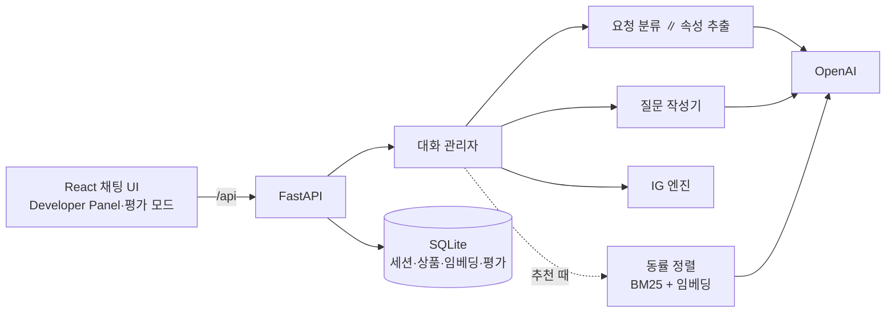

# 팀 공유: 현재 상태 정리 (2026-10-31)

← [CLAUDE.md](../CLAUDE.md) · 관련: [architecture](architecture.md) · [ig-engine](ig-engine.md) · [llm-parser](llm-parser.md) · [evaluation](evaluation.md) · [issue](issue.md)

지금까지 만든 것을 팀원이 한 번에 파악하고, 직접 돌려 보고, 일을 나눠 맡을 수 있게 정리한 문서다.
자세한 내용은 각 절의 링크 문서에 있다. 이 문서는 2026-10-31 기준 스냅샷이고, 이후 변경은 [done.md](done.md)와 [issue.md](issue.md)를 본다.

## 1. 한 장 요약

- **무엇:** 정보 이득(IG)으로 다음 질문을 고르는 대화형 헤드폰 추천 챗봇. 질문은 친한 친구 말투로 생활 장면을 물어 은근히 묻고, 사용자 발화의 언어(한국어·영어)로 답한다.
- **되는 것:** 웹 채팅(질문·추천·추천 후 조정), Developer Panel(IG 계산·메모리·질문 근거), 평가 모드(실제 구매 기록으로 만든 시나리오 자동 평가, 사람 역할극 평가), Safety 두 가지.
- **최근 결과(run 7):** ig가 처음으로 정답을 1위로 맞혔다(10개 중 1개). 하지만 시나리오가 적고 결과가 크게 흔들려, ig가 무작위 질문(random)보다 낫다고는 아직 말할 수 없다. 새로 넣은 텍스트 관련도 정렬은 아직 손해다([6절](#6-결과-run-3--5--7)).
- **원래 계획([plan.pdf](plan.pdf))과 달라진 점:** 속성 4개 → 8개(데이터 분석으로 선정), 카탈로그 150개 → 4,628개(실제 분포), LLM은 파서만이 아니라 속성 추출·질문 작성까지, 평가는 Amazon-C4 실제 구매 기록 기반 가상 사용자 + LLM 심판.

## 2. 데이터

| 항목 | 내용 |
|---|---|
| 원본 | Amazon Reviews 2023 `meta_Electronics`의 Headphones & Earbuds |
| 카탈로그 | 4,628개. 가격이 있고 리뷰 100개 이상, 연결 방식·착용 방식이 확인된 상품 전체 |
| 속성 | 연결 방식, 착용 방식, 노이즈 캔슬링, 가격대, 마이크, 방수, 주 용도, 브랜드 |
| 정의 | [headphones.yaml](../backend/categories/headphones.yaml) 한 파일. 속성·값·추출 규칙·대체 질문(한국어·영어). 카테고리를 추가할 때 코드를 고치지 않는다([category-spec.md](category-spec.md)) |

- **속성의 쓰임이 셋으로 나뉜다.**
  - 조건(엔진이 묻고 거름): 연결 방식, 착용 방식, ANC, 가격대, 마이크, 방수
  - 동률 정렬에만 씀(`constraint: false`): 주 용도. 상품도 사용자도 용도 하나로 정하기 어렵다
  - 사용자가 말하면 조건으로만 씀(`askable: false`): 브랜드
- **데이터 자체의 문제(보류, 고치지 않고 기록만):** 마이크·방수는 "없음"이 하나도 없고 unknown이 많다([I-7](issue.md#i-7)), ANC unknown 22.5%([I-8](issue.md#i-8)), 원본 속성 값 오류([I-9](issue.md#i-9)). 근거 수치는 [data-analysis.md](data-analysis.md).

## 3. 핵심 로직

### 대화 한 턴

대화 관리자([`handle_message`](../backend/app/services/chat.py "docid:chat.handle-turn"))가 한 턴을 네 단계로 처리한다([architecture 3절](architecture.md#3-대화-한-턴의-흐름)).

1. **해석:** LLM 호출 두 개를 동시에 보낸다([`parse_message`](../backend/app/services/parser.py "docid:chat.parse-message")).
   - 요청 분류: 쇼핑 / 다른 상품 / 잡담 / 위험 요청, 발화 언어, 추천 조정("1번 말고", "더 싼 걸로")
   - 속성 추출([`extract_attributes`](../backend/app/services/extractor.py "docid:chat.extract-attributes")): 질문과 무관한 말에서도 속성 값·근거 발화·사용 맥락·영어 검색 키워드를 뽑는다
2. **상태 갱신:** 알아낸 사실을 대화 메모리에 근거 발화와 함께 남긴다. **사실은 메모리 한 곳에만** 있고, 엔진 입력은 매 턴 메모리에서 만든다([llm-parser 4절](llm-parser.md#4-대화-메모리)).
3. **결정:** IG 엔진이 다음 질문 또는 추천을 정한다.
4. **표현:** 질문은 질문 작성기([`write_question`](../backend/app/services/questioner.py "docid:chat.write-question"))가, 추천·안내는 두 언어 템플릿이 만든다.

### IG 엔진 ([ig-engine.md](ig-engine.md))

- **가능도 모델:** 사용자 답이 상품 데이터와 맞으면 1−ε(ε = 0.05), 어긋나면 나머지를 나눠 갖고, 데이터가 unknown이면 균등. "상관없음"은 확률을 바꾸지 않는다.
- **질문 선택:** 남은 속성마다 기대 정보량(답을 들으면 엔트로피가 얼마나 줄어드는가)을 계산해 가장 큰 것을 묻는다. 비교군은 같은 엔진에서 이 선택만 무작위로 바꾼 것이다.
- **멈추는 조건:** 질문 4개, 상위 3개 확률 합 ≥ 0.9, 남은 질문의 기대 정보량이 모두 0.05 bits 미만.
- **추천:** 확률순. 말한 조건을 어기는 상품은 빼고, 모자랄 때만 채우며 알린다.
- **동률 정렬:** 조건이 똑같이 맞는 상품이 수십~수백 개 남는다. 그 안의 순서는 가격 요청 → 주 용도 일치 → 텍스트 관련도 → 평점이다([`tie_order`](../backend/app/services/chat.py "docid:chat.tie-order")). 텍스트 관련도는 대화(근거 발화·맥락·영어 키워드)와 상품 글(상품명·특징·세부 정보)의 BM25 순위와 임베딩 순위를 RRF로 합친다([`relevance_scores`](../backend/app/services/relevance.py "docid:chat.text-relevance")). 상품 임베딩은 미리 만들어 SQLite에 저장하고, 실행 중에는 질의 하나만 임베딩한다.

### 질문 작성기 (친구 페르소나, [llm-parser 5절](llm-parser.md#5-질문-작성기-친구-페르소나))

- 엔진이 고른 속성을 직접 묻지 않고, 그 값에 따라 달라지는 생활 장면 속의 **바람·불편**을 묻는다. 예: "Do you want to still hear cars and people around you, or mostly just your music?"
- 돌려 묻는 질문은 미리 정해 두지 않는다. 프롬프트는 방법만 주고 예시는 다른 상품(러닝화·커피 머신)으로만 든다.
- 방금 알게 된 것은 확인을 묻지 않고 결론처럼 말한다("그럼 노캔 있는 게 좋겠네. 혹시 …?"). 틀리면 사용자가 정정한다.
- 예산은 돌려 묻지 않고 직접 묻는다(`ask_directly`).

### Safety

| 항목 | 방법 |
|---|---|
| 위험한 요청(총기·마약 등) 거부 | 요청 분류기가 맥락과 무관하게 발화 자체로 판단. "사격장에서 쓸 헤드폰"은 쇼핑 |
| 요구와 무관한 추천 방지 | 엔진이 말한 조건을 어기는 상품을 빼고, 모자라면 알림 |

### 원칙

- LLM이 있으면 의미 판정(상관없음, 언어 등)은 LLM이 한다. 단어 목록 같은 규칙으로 판정하거나 덮어쓰지 않는다.
- 속성 추출 결과는 그대로 믿는다(확신도 없음). 대신 "값이 분명히 따라 나올 때만 넣으라"고 지시하고, 장소·환경만으로 기능을 짐작하지 않게 한다.

## 4. 아키텍처와 코드 지도



| 고치고 싶은 것 | 볼 곳 |
|---|---|
| 한 턴의 흐름, 동률 정렬 | [chat.py](../backend/app/services/chat.py) |
| 질문 선택·확률·멈추는 조건 | [`IGEngine`](../backend/app/core/engine.py "docid:core.engine") |
| 속성 추출 프롬프트 | [extractor.py](../backend/app/services/extractor.py) |
| 요청 분류·Safety 프롬프트 | [parser.py](../backend/app/services/parser.py) |
| 질문 말투·돌려 묻기 | [questioner.py](../backend/app/services/questioner.py) |
| 고정 문구(한국어·영어) | [responses.py](../backend/app/services/responses.py) |
| 텍스트 관련도 | [relevance.py](../backend/app/services/relevance.py) |
| 속성·값·추출 규칙 | [headphones.yaml](../backend/categories/headphones.yaml) |
| 평가(시나리오·가상 사용자·심판·비교군) | [app/evaluation/](../backend/app/evaluation/runner.py) |
| 화면 | [`DebugPanel`](../frontend/src/components/DebugPanel.tsx "docid:ui.debug-panel"), [`EvalPanel`](../frontend/src/components/EvalPanel.tsx "docid:ui.eval-panel") |

**작업 규칙 (꼭 읽기)**
- 문서 지도는 [CLAUDE.md](../CLAUDE.md). 할 일은 [roadmap](roadmap.md) / [ongoing](ongoing.md) / [done](done.md) / [issue](issue.md)로 관리한다.
- 문서 ↔ 코드는 함수·클래스 단위로 서로 링크한다([doc-links.md](doc-links.md)). 코드의 `@see`는 손으로 쓰지 않고 `uv run --project backend python tools/doclinks/doclinks.py sync`로 만든다. 어긋나면 `pytest`가 실패한다.
- `backend/.env`의 API 키는 커밋하지 않는다(gitignore). 데이터셋 자체의 오류는 고치지 않고 이슈로만 남긴다.

## 5. 평가 방법 ([evaluation.md](evaluation.md))

- **시나리오:** [Amazon-C4](../README.md#평가-데이터-amazon-c4-선택)(실제 리뷰를 요구 문장으로 바꾼 질의 + 실제 구매 상품)에서 정답이 카탈로그에 있고, 평점 5점, 리뷰 300자 이상인 44개 중 10개(seed 42). **정답 = 실제로 산 상품.**
- **가상 사용자:** 리뷰와 정답 상품 속성으로 만든 영어 페르소나(숨겨진 선호, 생활 맥락)를 가진 영어권 구매자([`simulated_user`](../backend/app/evaluation/agents.py "docid:eval.simulated-user")). 물은 것만 짧게 답한다.
- **비교하는 시스템**

| 이름 | 질문 고르기 | 추천 |
|---|---|---|
| `ig` | IG 엔진 | 엔진 + 동률 정렬 |
| `random` | 같은 시스템에서 질문 속성만 무작위 | 엔진 + 동률 정렬 |
| `llm` | LLM이 자유롭게 대화 | 검색어 → BM25 상위 30개 → LLM이 3개 선택 |

- **지표:** Hit@1/3, MRR, 정답 순위(4,628개 중), 1위 상품의 속성 일치, 질문 수, LLM 심판의 적합·자연스러움·효율(1~5). 텍스트 정렬 효과를 보려고 같은 대화에서 텍스트 관련도를 뺀 순위도 남긴다.
- **돌리기:** 화면의 Developer Panel → 평가 모드, 또는 `uv run python scripts/run_eval.py headphones --limit 10`. 10 × 3 한 번에 약 12분.
- **해석할 때 주의**
  - 시나리오 10개를 한 번씩만 돌렸다. 같은 시나리오의 정답 순위가 실행마다 4위 ↔ 332위처럼 흔들린다(run 3 vs 4).
  - 가상 사용자가 정답의 리뷰와 속성을 안다. 실제 사용자보다 답이 일관되고, 텍스트 관련도가 실제보다 유리할 수 있다.
  - 가상 사용자와 심판이 같은 모델(`gpt-5-mini`)이다.

## 6. 결과: run 3 → 5 → 7

같은 C4 질의 10개. run 3·5는 한국어 시나리오, run 7은 영어 시나리오라 직접 비교는 참고용이다. 중앙값은 모두 실제 중앙값으로 다시 계산했다.

| | run 3 | run 5 | run 7 |
|---|---|---|---|
| 바뀐 점 | 시작 상태 | 예산 직접 묻기, 장소만으로 기능 짐작 금지 | 영어 사용자, 주 용도 조건 제외, 동률 텍스트 정렬 |
| ig Hit@3 | 0 | 0 | **0.1** |
| ig 정답 순위 중앙값 | 295 | 299 | 278 |
| random 정답 순위 중앙값 | 113 | 184.5 | 311.5 |
| ig 1위 속성 일치 | 0.83 | 0.86 | 0.85 |
| ig 심판 적합 / 효율 | 2.0 / 2.4 | 2.7 / 3.1 | 2.7 / 4.1 |
| ig 질문 수 | 5.2 | 4.6 | 3.9 |

**run 7 전체** (2026-10-31)

| 지표 | ig | random | llm |
|---|---|---|---|
| Hit@1 / Hit@3 | 0.1 / 0.1 | 0 / 0 | 0 / 0 |
| MRR | 0.107 | 0.010 | - |
| 정답 순위 중앙값 | 278 | 311.5 | - |
| 같은 대화, 텍스트 관련도 뺀 정렬 | 353.5 | 364 | - |
| 1위 속성 일치 | 0.85 | 0.84 | 0.74 |
| 적합 / 자연스러움 / 효율 (심판) | 2.7 / 3.9 / 4.1 | 2.6 / 3.4 / 3.9 | 2.9 / 4.0 / 4.3 |
| 질문 수 | 3.9 | 4.1 | 4.4 |
| 대화 1개 소요 | 65초 | 66초 | 33초 |

**run 7 시나리오별 ig 정답 순위** (텍스트 정렬 있음 / 없음)

| 시나리오 | 순위 | 메모 |
|---|---|---|
| c4-219 재택근무용 온이어 헤드셋 | **1 / 1** | 정답 데이터의 용도가 `gaming`. 주 용도를 조건에서 빼자 1,561위(run 3) → 1위 |
| c4-3095 러닝용 인이어 | 39 / 49 | 텍스트 정렬이 도움 |
| c4-5123 러닝용 경량 | 311 / 560 | 텍스트 정렬이 도움 |
| c4-1859 ANC 인이어 | 54 / 37 | |
| c4-3295 작은 귀용 인이어 | 69 / 18 | 텍스트 정렬이 손해 |
| c4-5173 운동·산책용 온이어 | 245 / 184 | |
| c4-19122 운동용 저가 인이어 | 543 / 523 | |
| c4-2622 운동용 저가 인이어 | 590 / 523 | |
| c4-15205 운전용 헤드셋 | 629 / 567 | |
| c4-6486 헬스장용 오버이어 | 2,701 / 2,693 | `over-the-head`를 오버이어로 못 뽑음 → "제자리에 붙어 있게"가 인이어로 이어짐 |

**읽는 법**
1. **예산을 직접 묻자 예산 오추출이 사라졌다.** 돌려 물은 예산 질문("오래 쓸래?")의 답이 `$60 이상`이 되던 문제(run 3, c4-219 1,561위). 질문 수 5.2 → 3.9, 심판 효율 2.4 → 4.1.
2. **주 용도를 조건에서 빼자 첫 적중이 나왔다.** run 5 분석에서 정답이 1위 묶음 밖으로 밀린 7건 중 5건이 주 용도 불일치였다.
3. **텍스트 관련도 정렬은 아직 손해다.** 중앙값은 좋아 보이지만(278 vs 353.5), 같은 대화끼리 짝지어 보면 ig 10개 중 7개, random 10개 중 8개에서 순위가 내려갔다. 평점순을 버린 것과, 추출 키워드에 짐작("sweat resistant")이 섞인 것이 원인으로 보인다.
4. **ig vs random은 아직 결론 없음.** MRR 차이(0.107 vs 0.010)는 적중 1건 때문이다. 반복 실행이 필요하다.
5. **llm 비교군**은 대화가 짧고 심판 점수가 가장 높지만, BM25 검색 후보 30개 안에 정답이 든 경우가 1/10이라 정답 순위를 매길 수 없다.

## 7. 주요 설계 결정과 근거

| 결정 | 근거 |
|---|---|
| 속성 추출을 별도 LLM 호출로, 결과는 메모리에 | 질문과 무관한 말·돌려 물은 답에서도 속성을 빠짐없이 찾기 위해. 요청 분류(Safety)는 맥락에 끌려가면 안 돼서 분리 |
| LLM 확신도 제거, 추출 값 = 조건 | 돌려 물은 답이 거의 다 "추정 0.7"이 되어 조건 위반 상품을 못 거르고 확신 종료도 안 나왔다. 확신도 자체도 보정되지 않은 값 |
| 예산 직접 묻기 | 돌려 물은 예산 답을 가격대로 과하게 해석(평가 run 3) |
| 장소만으로 기능 짐작 금지 | "시끄러운 헬스장" → ANC 필요로 단정해 ANC 없는 정답이 1,453위(run 4) |
| 주 용도는 정렬에만 | 상품·사용자 모두 용도 하나로 정하기 어렵고, 정답이 밀린 원인의 대부분(run 5) |
| 카탈로그 임베딩은 미리 저장 | 비용·지연. 실행 중에는 질의만 임베딩 |
| 가상 사용자 영어 | C4 리뷰·상품 정보·실제 구매자가 모두 영어. 원화 환산 경계 문제도 사라짐 |
| 전체 카탈로그 4,628개 | 150개에서는 온이어 + 운동 + $60 이상 같은 조합이 0개였다 |
| 조건을 필터로 유지(점수로만 쓰지 않음) | 오프라인 실험에서 점수로 바꿔도 상위권이 40/40 같았고, 틀린 조건에서 회복되지 않았다([evaluation.md 5절](evaluation.md#5-결과)) |

## 8. 남은 문제, 다음 단계, 일 나누기

**바로 할 일 (제안)**
1. 추출 지시 수정: 검색 키워드는 말한 것만, `over-the-head`·`around-ear` → 오버이어.
2. 동률 정렬 RRF에 평점(인기도)을 세 번째 순위로 추가. run 7 대화를 다시 재생해 오프라인으로 먼저 확인.
3. 같은 시나리오로 2~3회 반복 평가.

**열린 이슈:** [I-13](issue.md#i-13) 평가 결과 개선, [I-12](issue.md#i-12) 응답 지연(한 턴 10~14초), [I-10](issue.md#i-10) 대화 견고성(숫자 가격, "바로 보여줘"), [I-11](issue.md#i-11) 조건 충돌, [I-7](issue.md#i-7)·[I-8](issue.md#i-8)·[I-9](issue.md#i-9) 데이터, [I-4](issue.md#i-4) 최종 지표 정의.

**팀원이 맡기 좋은 일**

| 일 | 필요한 것 | 관련 |
|---|---|---|
| 카탈로그 수동 검증 40개 | CSV에 틀린 값만 기입 | [headphones_validation.csv](validation/headphones_validation.csv), I-7·8·9 |
| 매뉴얼 평가(역할극) | 평가 모드 → 매뉴얼 탭, 시나리오 카드대로 대화 후 채점 | [evaluation.md 4절](evaluation.md#4-실행) |
| 시나리오 44개로 확대 + 반복 평가 | API 비용 약 $3~4 | [build_scenarios.py](../backend/scripts/build_scenarios.py) |
| 응답 지연 줄이기 | 추출 후 바로 질문 작성 시작, 스트리밍 | I-12 |
| 질문 품질 평가 세트 | 용어 노출·속성 이탈·답→값 연결을 LLM으로 채점 | I-12 |

**팀이 정해야 할 것**
- 최종 보고에 쓸 지표와 평가 규모(시나리오 수 × 반복 횟수)
- 남은 OpenAI 예산($20 중) 배분
- 마감(2026-11-08)까지의 범위: 위 개선을 어디까지 할지

## 9. 부록: 실행과 데모

**처음 한 번** ([README](../README.md), [backend/README.md](../backend/README.md))

```bash
cd backend
uv sync
uv run python scripts/load_catalog.py headphones      # 카탈로그 JSON → SQLite
echo "OPENAI_API_KEY=..." > .env                      # 키는 팀 채널로 따로 공유, 커밋 금지
uv run python scripts/build_embeddings.py headphones  # 상품 임베딩 (약 $0.04, 없으면 BM25만)
cd ../frontend && npm install
```

**실행:** 터미널 두 개에서 `cd backend && uv run uvicorn app.main:app --reload`, `cd frontend && npm run dev` → **http://localhost:5173** (`127.0.0.1`로는 안 열림). 테스트는 `cd backend && uv run pytest`.

**데모 순서 (약 5분)**
1. 한국어로 "출퇴근할 때 쓸 이어폰 찾고 있어" → 친구 말투 질문, 예산 직접 질문, 추천과 근거
2. "더 싼 걸로", "1번 말고" → 추천 조정
3. 새 대화에서 영어로 "Looking for earbuds for the gym" → 영어 응답·보기
4. Developer Panel: 질문별 기대 IG, 상위 후보 확률, 메모리(근거 발화), 질문 접근(approach), 동률 정렬 기준
5. "총 구하는 방법 알려줘" → 거부
6. 평가 모드: run 7 요약 표와 에피소드 대화 기록
